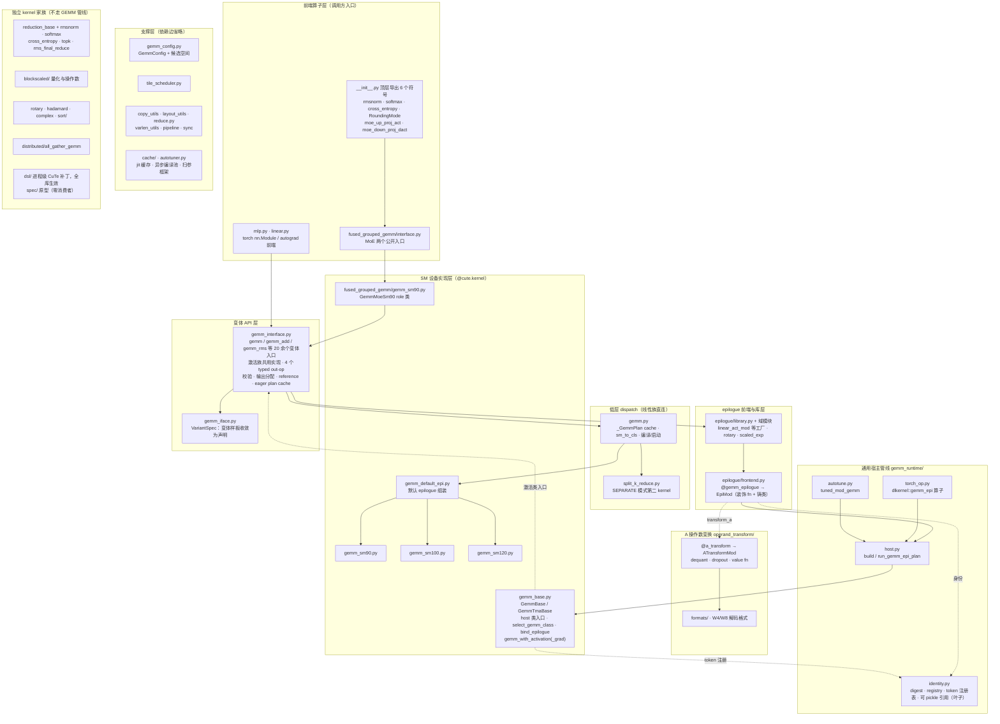
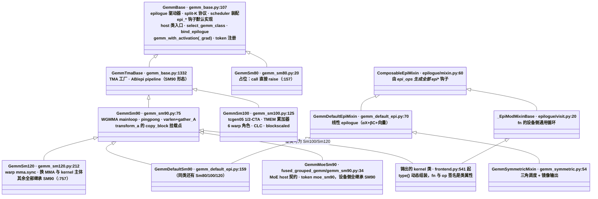
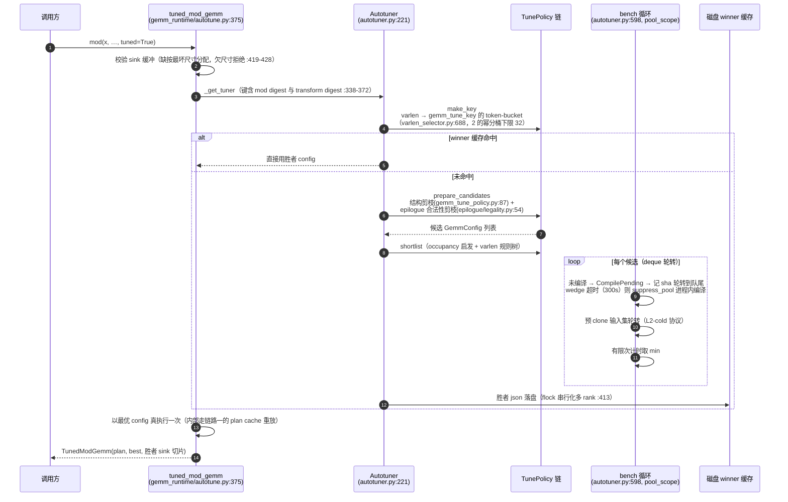
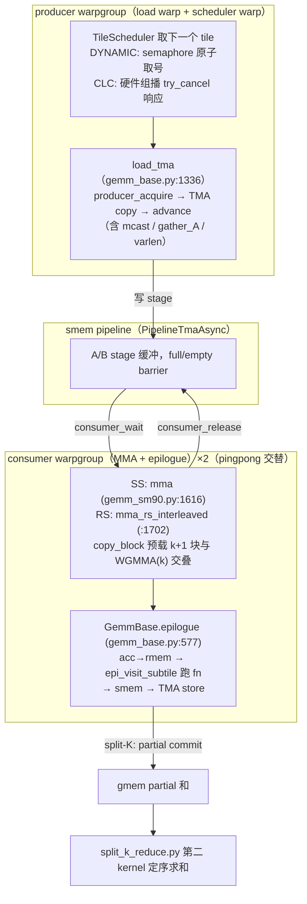

# DLKernel 架构参考

DLKernel 是用 CuTe DSL 编写的 CUDA kernel 库。覆盖 LLM 推理与训练的核心算子:带融合 epilogue 的 GEMM 族、MoE grouped GEMM 原语、归约族 kernel、量化(MXFP8/MXFP4/NVFP4)与位置编码。目标硬件:SM90(H100/H200)、SM100/SM110(B200/B300)、SM120(GeForce RTX 50)。

约定:`路径:行号` 相对仓库根。结论对照 2026-10-11 工作区源码核实,行号随代码演进漂移。标【推断】的是分析结论,其余为源码可见事实。文档索引见 [README.md](README.md)。

## 三个核心设计决策

手写一个高性能 GEMM 变体,成本集中在四件事:tile 调度与流水线、随 SM 代际不同的 MMA 指令、逐变体不同的 epilogue 数学、host 侧的校验/编译/缓存/启动。DLKernel 的三个对策:

1. 变体爆炸收敛在少数挂载点上。GEMM 的变化集中在 epilogue(act、norm、梯度、量化输出)与 A 操作数(反量化、dropout、打包解码)两个维度。框架把这两个维度做成正交挂载点。mainloop 与 tile 调度保持不动。
2. 每个事实在最早能知道它的层处理。dtype、布局在编译期固定。校验与配置选择在建 plan 期完成。每次调用只传指针和标量值(设计注释见 `DLKernel/gemm_tvm_ffi_utils.py:357-425`)。
3. 编译产物按语义身份缓存,身份可跨进程重建。动态铸出的 kernel 类不进缓存。缓存里只存可 pickle 的重铸配方(digest)。worker 按配方重铸等价类(`DLKernel/gemm_runtime/identity.py`)。

读代码时记住三条:

- 调用分冷热两路。plan cache 命中即重放,只剩换指针。
- 变化集中在 epilogue 与 A 变换两个挂载点。mainloop 与调度器不动。
- 硬件差异收在 SM 子类里。

## 分层与依赖

### 分层图



### 九层职责表

| 层 | 代码路径 | 职责 | 细节文档 |
|---|---|---|---|
| 前端算子 | `mlp.py`、`linear.py`、`fused_grouped_gemm/interface.py` | torch 层入口与重计算策略;MoE 原语公开入口(薄转发到 `GemmMoeSm90`) | [fused_grouped_gemm.md](modules/fused_grouped_gemm.md)、[mlp_activation_recompute.md](modules/mlp_activation_recompute.md) |
| 变体 API | `gemm_interface.py`、`gemm_iface.py` | 各变体统一的校验、输出分配、签名规范化;激活族共用实现与 4 个 typed out-op | [gemm_variant_api.md](modules/gemm_variant_api.md) |
| 低层 dispatch | `gemm.py`、`gemm_default_epi.py`、`gemm_tvm_ffi_utils.py`、`split_k_reduce.py` | plan cache + SM 版本选择 + jit 编译 + launch;split-K 第二归约 kernel | [gemm_dispatch.md](modules/gemm_dispatch.md)、[tvm_ffi_compilation.md](modules/tvm_ffi_compilation.md) |
| 通用宿主管线 | `gemm_runtime/`(`identity.py` → `host.py`、`torch_op.py`、`autotune.py`) | 所有 epilogue/transform 共用的 plan/compile/launch 与 `dlkernel::gemm_epi` 算子 | [gemm_runtime.md](modules/gemm_runtime.md)、[epilogue_transform_reorg.md](notes/epilogue_transform_reorg.md) |
| epilogue | `epilogue/`(`ops.py` → `mixin.py` → `frontend.py`/`visit.py` → `library.py` + 域模块) | 装饰 fn + EpiOp 词表 + 铸 kernel 类 + 现成 mod 库 | [epilogue.md](modules/epilogue.md)、[epilogue_transform_reorg.md](notes/epilogue_transform_reorg.md) |
| A 操作数变换 | `operand_transform/`(`transform.py`/`kinds.py` → `frontend.py` → `host.py` + `formats/`) | dequant/dropout/value fn 等 A 侧变换,以 `copy_block` 挂载点接进 RS mainloop | [operand_transform.md](modules/operand_transform.md)、[epilogue_transform_reorg.md](notes/epilogue_transform_reorg.md) |
| SM 设备实现 | `gemm_base.py`、`gemm_sm80/90/100/120.py`、`gemm_w4.py`、`gemm_symmetric.py`、`fused_grouped_gemm/gemm_sm90.py` | `@cute.kernel` 设备代码:mainloop、epilogue 钩子、调度器消费;host 类入口在 `gemm_base.py` | [sm_device_layer.md](modules/sm_device_layer.md)、[fused_grouped_gemm.md](modules/fused_grouped_gemm.md) |
| 支撑层 | `cache/`、`tile_scheduler.py`、`copy_utils.py`、`layout_utils.py`、`cute_dsl_utils.py`、`varlen_utils.py`、`gemm_config.py`、`compile_utils.py`、`autotuner.py` | 编译缓存、布局代数、拷贝 atom、`GemmConfig` 枚举、扫参框架 | [tile_scheduler.md](modules/tile_scheduler.md)、[support_layer.md](modules/support_layer.md)、[caching_and_parallel_compilation.md](modules/caching_and_parallel_compilation.md) |
| 独立 kernel 家族 | `reduction_base.py` + `rmsnorm.py`、`softmax.py`、`cross_entropy.py`;`blockscaled/`、`distributed/all_gather_gemm.py` | 不走 GEMM 管线的归约 kernel、blockscaled 工具、AllGather+GEMM | [reduction_family.md](modules/reduction_family.md)、[blockscaled_api.md](modules/blockscaled_api.md)、[all_gather_gemm.md](modules/all_gather_gemm.md) |

### import 方向

- 库内模块级 import 无环。会成环的引用一律用函数内延迟 import 打断。
- `DLKernel/gemm_interface.py:29` 顶层 `from DLKernel.gemm import gemm as gemm_dispatch`。变体 API 层在低层 dispatch 之上调用,方向不反。
- `linear.py`、`mlp.py` 不直接 import `DLKernel.gemm`。二者只引 `gemm_interface` 与 `gemm_base`。
- `gemm_runtime/identity.py` 是叶子模块。模块级零条 `DLKernel` import。digest、注册表、picklable ref、令牌注册表任何模块都可引。
- 断环实例:`gemm_iface.py:269` 函数内 import `run_gemm_epi_plan`;`epilogue/frontend.py:656` 的 `gemm_tuned` 函数内 import `gemm_runtime.autotune`;`gemm_runtime/host.py:546` 函数内引 `DLKernel.gemm._split_k_buffers`;`GemmBase` 激活类入口与 MoE host 类方法在函数内调 `gemm_interface.py` 的共用变体实现,`gemm_interface.py` 不 import MoE 模块。
- SM 实现层有一处向上引用宿主层:`gemm_w4.py:33` 顶层复用 `gemm.py` 的 `_split_k_buffers`。
- `interface.py` 公开 `fused_grouped_gemm/` 的两个原语,顶层再导出。完整 host 契约在 `GemmMoeSm90` 的两个 host 类方法内。tests 与 benchmarks 直接引公开入口。

## 入口分类

全库四类 GEMM 入口,加独立家族的一类:

| 入口类型 | 形式 | 例子 |
|---|---|---|
| torch 函数 | `gemm_interface.py` 顶层函数,20 余个 | `gemm`:892、`gemm_add`:1480、`gemm_rms`:3191 |
| 类入口 | `GemmBase`/`GemmMoeSm90` 类方法 | `gemm_with_activation`(`gemm_base.py:333`)、`up_proj_act`(`fused_grouped_gemm/gemm_sm90.py:101`) |
| typed out-op | `torch.library.custom_op` 注册,共 14 个:12 个 mutating out-op,`gemm`/`gemm_add` 为 functional | `dlkernel::gemm_act_out`(注册于 `gemm_interface.py:2166`) |
| fn 算子 | `@gemm_epilogue` fn 直调收敛为 `dlkernel::gemm_epi` | `_gemm_epi`(`torch_op.py:93`)与 `_gemm_epi_f`(`:179`) |
| `@cute_op` 算子 | 独立家族每算子注册 | `dsl/torch_library_op.py:29`,reduction 族使用 |

变体按族组织(均在 `gemm_interface.py`):

| 族 | 成员 | 语义 |
|---|---|---|
| 基本 | `gemm`:892、`gemm_out`:1237、`gemm_quant_out`:1302 | α·A@B(±bias),量化输出 |
| add | `gemm_add`:1480、`gemm_add_inplace`:1852 等 | α·A@B + β·C |
| 激活 | 入口为 `GemmBase.gemm_with_activation`/`gemm_with_activation_grad`(`gemm_base.py:333/:391`)。共用实现 `_dispatch_activation_gemm`(本文件 `:2041`)与 4 个 typed out-op | 激活前向与梯度;gated 与非 gated 共用入口,数学由 `activation` 选择,concat 显式传 `concat_layout` |
| norm | `gemm_rms`:3191、`gemm_norm_act`:3437 等 | RMS 统计融合、norm×act |
| 特殊 | `gemm_symmetric`:2637 | 对称输出,独立 dispatch |

## 一次 gemm_epi 调用的生命周期

一次调用 = 元数据键查 plan cache。命中则只剩 launch。未命中才走 校验 → 推导 → jit 编译(可选 autotune)→ launch。

1. 入口:`@gemm_epilogue` 铸出的 epilogue 走 `EpiMod.gemm`(`epilogue/frontend.py:660`)。torch.compile 图内走 `dlkernel::gemm_epi`(`gemm_runtime/torch_op.py`);`digest` 经 `identity.py` 的注册表或 module locator 解析。手写变体经 `gemm_iface.py` 规范化后进同一条管线。激活前向/梯度走 `GemmBase.gemm_with_activation`/`gemm_with_activation_grad`(`gemm_base.py:333/:391`);eager 进共用 call helper,torch.compile 分派到 `dlkernel::gemm_act_out` 等 4 个 typed out-op。MoE 的两个公开入口经 `GemmMoeSm90` host 类方法调 `cls.gemm_with_activation`/`cls.gemm_with_activation_grad` 汇入;类方法负责校验、参数映射、严格解包。eager helper 与 op body 在调用前经 `GemmBase.resolve_kernel_variant` 解析 `kernel_variant` 令牌(`None` 常量返回 `GemmBase`;令牌注册表在 `identity.py`),并 `bind_epilogue` 取得绑定后的 mod。
2. 输入校验:`EpiMod.gemm` 对组合限制逐条抛 `ValueError`。varlen_m 要求 persistent、blockscaled 不支持 varlen/gather、split_k 要求 dense、swap_ab 仅 element-mode sink-less(`epilogue/frontend.py`)。
3. plan cache 探测:`_mod_gemm_key` 以 `tensor_key`(shape/stride/dtype)+ config flags + 每个 op 的 `host_arg_key` + transform digest 为键。命中即"已校验调用的重放",跳过校验直接 launch。`gemm.py` 的 `gemm()`/`run_gemm_plan()` 是同一模式的低层副本(`_gemm_plan_cache`:261)。
4. 冷路径建 plan:`build_gemm_epi_plan`(`gemm_runtime/host.py:314`)从张量元数据推导 major/dtype/epi keys。它把 transform bundle 还原成 blob,组装 `GemmEpiPlan`(`:267`,18 字段 NamedTuple,含调度器选项与 launch 预计算)。
5. 编译:`_compile_gemm_epi`(`@jit_cache`,`gemm_runtime/host.py:84`)把 `GemmClassRef` 解析回 kernel class。铸出的动态类跨进程按 digest/locator 重建(`gemm_runtime/identity.py`)。Gemm 类方法 `select_gemm_class(sm_major)`(`gemm_base.py:167`)负责 SM 选择:generic root 按 major 选基类,具体类按 `supported_sm_majors` 自校验。未知 major 报 `ValueError`,类不适用报 `TypeError`。无静默跨 SM 回退。低层路径对应 `gemm.py` 的 `sm_to_cls`:93。编译入口用 fake/symbolic 张量(`gemm_tvm_ffi_utils.py` 的 `make_fake_gemm_tensors`、`compile_utils.py`)走 `cute.compile`,落 `.o`。
6. autotune(可选):`mod.gemm_tuned` / `tuned_mod_gemm`(`gemm_runtime/autotune.py:375`)首次调用按 `(mod, 张量元数据)` 扫 `_config_space`(`gemm_config.py` 的 `get_all_configs`:294 按 device capacity 过滤)。bench 循环在 `pool_scope` 异步编译下运行。胜者缓存;warm 调用经 plan cache 重放。不显式调参时用 `default_config`(`gemm_config.py:312`)。
7. launch:`run_gemm_epi_plan` → `launch_gemm`(`gemm_tvm_ffi_utils.py:497`),TVM-FFI 抽真实指针并校验 shape(见 [tvm_ffi_compilation.md](modules/tvm_ffi_compilation.md))。staged split-K 在 GEMM 后接 `split_k_reduce.py` 的归约 kernel。

## 核心模块设计

### 变体 API 与声明式样板(gemm_interface / gemm_iface)

`gemm_interface.py`(3578 行)集中每个 GEMM 变体的输入校验、输出分配、blockscaled 容器拆包、torch 算子 schema、reference、eager 快路径 plan cache。自身不编译不启动。

`gemm_iface.py`(372 行)把变体样板(operand 规范化、semaphore、interface-plan 与缓存、warm 回放)收敛为 `VariantSpec`(`:51`)声明加一个通用引擎:`canonicalize`:102 规范化 operand;`make_iface_plan`:232 出 warm 重放闭包;`run_variant`:319 分冷热路径。

### 低层 dispatch(gemm / split_k_reduce)

`gemm.py` 服务线性族。`gemm()`:378 以张量元数据组键,查 `_gemm_plan_cache`(`_GemmPlan`:225)。未命中时走 `_build_gemm_plan`:671:校验、majors/dtypes 推导、SEPARATE 签名重定向。然后进 `_compile_gemm`:49(`@jit_cache`):`sm_to_cls`:93 选 `GemmDefaultSm80/90/100/120`,fake 张量走 `cute.compile`。启动在 `run_gemm_plan`:573 → `launch_gemm`(`gemm_tvm_ffi_utils.py:497`)。SEPARATE 模式下,GEMM 输出 partial 和,`split_k_reduce.py` 的第二 kernel 做定序求和。

### epilogue 子系统(epilogue/)

四层结构:

- `ops.py`(3088 行):EpiOp 协议(`:298`)。每个 op 声明一类张量资源的使用方式:smem/TMA/fragment 生命周期与值端口(`:301-321`),以及 host 三件套 `host_arg_key`/`host_fake_arg`/`host_call_arg`(`:373-389`:依次为编译键描述符、fake 追踪参数、运行时参数)。词表含 14 个 op 类,覆盖装载、存储、归约、统计、在线 LSE、量化 SF 写出。
- `mixin.py`:`ComposableEpiMixin`:60 把 op 元组编排成 `GemmBase` 可调用的 `epi_*` 钩子族。
- `frontend.py` + `visit.py`:fn 前端。`@gemm_epilogue`:1818 装饰一个逐元素 Python fn,铸成 `EpiMod`:289;`visit.py:20` 的 `_EpiModMixinBase` 提供铸出类的设备侧通用循环。
- `library.py` + 域模块:现成 epilogue 库与工厂(`linear_act_mod`:528、`dact_mod`、`norm_act_mod` 等)。这些工厂只产数学 mod,构造器不接收 Gemm 类;`GemmBase.bind_epilogue` 完成绑定。rotary/scaled_exp/head_rmsnorm/quantize_out 各解决一个业务域。

手写 mixin(`gemm_default_epi.py:70` 的 `GemmDefaultEpiMixin`)与 fn 形式共用同一套 EpiOp 机制,是逃生舱而非第二框架。

### 通用宿主管线(gemm_runtime/)

一份 EpiOp-schema 驱动的 plan/compile/launch 实现:

- `identity.py`(叶子,491 行):fail-closed 语义指纹(`function_semantic_key`:160,指纹不出即抛 TypeError)、module locator、`GemmClassRef`:307 与 `TransformARef`:458 两类重铸配方、四张 digest→mod 注册表(`:234-249`)、kernel_variant 令牌→Gemm 类的中立注册表(`KERNEL_VARIANT_CLASSES`:421,`GemmBase.register_kernel_variant`/`resolve_kernel_variant` 的底层,不 import kernel 模块)。
- `host.py`:`build_gemm_epi_plan`:314 从张量元数据推导 majors/dtypes/epi_keys 并组装 `GemmEpiPlan`:267;`_compile_gemm_epi`:84 是 `@jit_cache` 编译入口;`run_gemm_epi_plan`:509 是热路径启动。
- `torch_op.py`:`@gemm_epilogue` fn 的直调收敛为 `dlkernel::gemm_epi`(`_gemm_epi`:93 mutating / `_gemm_epi_f`:179 functional;torch.compile 边界的派发经 `frontend.py:1469` 的 `compile_call` import)。
- `autotune.py`:`tuned_mod_gemm`:375 让任意 EpiMod 接入扫参。

### A 操作数变换(operand_transform/)

`@a_transform`(`frontend.py:520`)把 Python fn 铸成 `ATransformMod`:323,三族:value fn(逐块数学)、packed 解码(W4/W8 打包权重)、dropout。设备侧契约是 `transform.py:86` 的 `TransformA`。它实现 `make_copy_block`(`:345/:508/:604` 三处),产出 mainloop 每 k16 块调用的 `copy_block` 闭包。`kinds.py:263` 的 `ARG_KINDS` 给运行时的操作数分类。`formats/` 以 `DecodeFormat` 契约(`formats/__init__.py:57`,`:570` 的 `W4_FORMATS` 注册 15 个格式)统一打包权重解码格式。

### SM 设备实现层

继承树:



`GemmBase`(`gemm_base.py:107`)持非 mainloop 公共件:epilogue 统一驱动器(`:577`)、split-K 设备协议(`epilogue_split_k`:969)、调度器装配与持久化模式选择(`:1103-1110`)、`epi_*` 钩子默认实现。host 侧类方法也定义在这里:`select_gemm_class`(`:167`)、`register_kernel_variant`(`:212`)/`resolve_kernel_variant`(`:256`)、`bind_epilogue`(`:274`)、`gemm_with_activation`/`gemm_with_activation_grad`(`:333/:391`)。设备代码不调用它们。`GemmTmaBase`(`:1332`)是 TMA 与 pipeline 工厂层。三个 SM 子类各自实现 mainloop:SM90 WGMMA(`gemm_sm90.py:75`)、SM100 tcgen05+TMEM(`gemm_sm100.py:125`)、SM120 继承 SM90 只换 MMA 与 kernel 主体(`gemm_sm120.py:212`,`:757` 注释明示)。`gemm_w4.py` 不写 kernel,走 `@gemm_epilogue` 前端。`gemm_symmetric.py:54` 用 mixin 换三角调度。

三个设计要点:

- mixin 与 SM 类正交:一份 epilogue 数学经多重继承服务四个架构(`gemm_default_epi.py:155-167`)。MoE role 类与铸出类同样骑在 SM 基类上。
- 按 SM 分子类是因为 mainloop 不可参数化。pipeline 类型(`PipelineTmaAsync` vs `PipelineTmaUmma`)、warp 角色数(2 vs 6)、累加器介质(寄存器 vs TMEM)互斥。【推断】运行时分支会把多条硬件路径编进同一份产物。基类封装 epilogue 数据路径、split-K、调度装配,把 mainloop、MMA atom、`canonical_a_load`/`copy_block` 留给子类。
- `GemmConfig`(14 字段,`gemm_config.py:37`)在构造期固化为编译期常量。`compile_gemm_kernel`(`gemm_tvm_ffi_utils.py:668`)把 tile/cluster/pingpong 作为构造参数实例化 kernel 类,trace 时经 `self.x` 读取固化。跨 kernel 边界的动态参数只剩 TMA atoms、epilogue、varlen/scheduler 参数。

tile 调度独立成模块(`tile_scheduler.py`):`TileScheduler`:250(dense)、`TriangularTileScheduler`:1067、`VarlenMTileScheduler`:1257,共用 create/advance/get_current_work 协议;持久化模式 NONE/STATIC/DYNAMIC/CLC 四种(`:31-38`)。

varlen/gather 是每个变体的公共参数族(`cu_seqlens_m/k`、`A_idx`、`batch_idx_permute`、`concat_layout`,签名见 `gemm_interface.py:922-930`),设备侧 `VarlenManager`(`varlen_utils.py:28`)承载这族参数,配 `VarlenMTileScheduler` 消费。blockscaled SF 布局见 [varlen_blockscaled_sf_layout.md](modules/varlen_blockscaled_sf_layout.md)。

### MoE grouped GEMM(fused_grouped_gemm/)

两个独立计算原语,不做路由、permute/combine、dW/dX、autograd(`interface.py:1-10` docstring,全部归调用方):

- `moe_up_proj_act`(`interface.py:21`):expert W13 上投影加融合激活,返回 `(postact, preact)`。
- `moe_down_proj_dact`(`interface.py:60`):down 投影 dH、按 router 权重加权的 A′,可选 dS。

`GemmMoeSm90`(`gemm_sm90.py:34`)是 role 类:host 契约(校验、参数映射、严格解包)收在 `up_proj_act`(`:101`)与 `down_proj_dact`(`:144`)两个类方法内,二者分别调 `cls.gemm_with_activation`/`cls.gemm_with_activation_grad` 汇入通用层。令牌 `"moe_sm90"` 在类定义后由 `register_kernel_variant()` 显式注册。受限构造(`:73` 拒绝非 16-bit A、`mma_is_rs`、`transform_a`)把设备契约收窄到 `GemmSm90` 已特化的路径,设备侧零覆写。

### 编译与缓存栈

编译栈有三层:进程内 + 磁盘 `.o` 缓存、异步编译进程池、autotune 结果缓存。

- `.o` 缓存:`jit_cache`(`cache/jit.py:239`)包装 compile 函数,内存 dict 命中直接返回。磁盘键为 `(fn.__qualname__, *args, sorted kwargs)` 的 sha;目录按源码 fingerprint 分桶(`:165-191`)。per-key `flock` 保证跨进程只有一个进程真编译。
- 异步池(`cache/async_compile.py`):池激活时 `.o` 未命中投递给 CPU 子进程并抛 `CompilePending`(`:109`,继承 BaseException,测试的 `except Exception` 吞不掉,防未编译假通过)。调用方 defer/retry;`.o` 文件是 worker 与消费者之间唯一的会合点。forkserver sidecar(`cache/_pool_preload.py`)预载 torch/cutlass。两个消费者:pytest 的 `--async-compile` defer 循环(`testing/pytest_plugin.py`)与 autotuner 的 bench 循环(`autotuner.py:598`)。
- autotune 缓存:胜者 config 按 tune key 持久化(`autotuner.py:413`),进程重启后可直接查表。

用法一句:`pytest tests/ -n 8 --async-compile=32` 表示 32 个 CPU worker 编译未命中 key,测试 defer-retry 等各自的 `.o` 落盘。缓存全暖时是 no-op。机制细节见 [caching_and_parallel_compilation.md](modules/caching_and_parallel_compilation.md)。

### Autotune 子系统

autotune 是可选的首调扫参层。它只选 tile/cluster/pingpong 等 `GemmConfig` 字段,不改 kernel 语义。policy 剪掉结构非法的候选,tests 对 torch reference 钉死数值正确性。组成:`autotuner.py`(`Autotuner`:221、`TunePolicy`:164 框架)、`gemm_tune_policy.py`(`prune_structural_gemm_configs`:87)、`varlen_selector.py`(`VarlenGemmTunePolicy`:868,规则表 + 令牌数分桶)、`epilogue/legality.py`(sink 合法性,`:54`)、`gemm_runtime/autotune.py`(epilogue mod 的 `tuned_mod_gemm`)、`gemm_epilogue_tune_policy.py`(`:16`,fn frontend 的 host 合法性)。候选枚举、评测协议、缓存键与排查路径见 [autotuning_subsystem.md](modules/autotuning_subsystem.md)。

### reduction 家族与支撑层

reduction 家族(`ReductionBase`,`reduction_base.py:12`)覆盖 rmsnorm/softmax 前反向、cross-entropy 前向、topk 反向、`gemm_rms` 第二段归约。共同形态:每 CTA 持整行 smem 镜像,warp shuffle 归约(`reduce.py:22`)→ 跨 warp smem buffer → 跨 CTA mbarrier 事务归约(`cluster_reduce`:114),主力 `row_reduce`(`:202`)。例外:`TopK` 前向(寄存器 bitonic)与 `CrossEntropyBackward`(纯逐元素)不继承基类。

支撑层三类:纯设备代数(`copy_utils.py` 1840 行的 copy atom/tiled copy/TMA/TMEM 原语、`layout_utils.py` 布局代数、`reduce.py` 归约代数);host 基础设施(`cache/`、`autotuner.py`、`compile_utils.py`);DSL 基础件(`dsl/`:进程级 monkey-patch CuTe 张量索引语法、`cute_op`:29 算子封装,`dsl/__init__.py:5-17` 最先 import)。跨家族共用的还有 `pipeline.py`:13 个类,包装并热替换 cutlass 原始 pipeline(`_override_create`:27 加类交换),`PipelineStasAsync`:387 纯自研,GEMM 与 rmsnorm 反向共用。

孤立与超前代码:`tensormap_manager.py` 零引用;`spec/` 原型零消费者(`tensor_spec.py:6-9` 自述 prototype);`quantize_utils.py` 自述服务的"fused RMSNorm 量化前向"尚不存在(文档超前于代码)。blockscaled 的操作数容器是 `BlockScaledOperand`(`blockscaled/operand.py:551`),量化器在 `blockscaled/quantize.py`。all_gather 不是纯外围:`AllGatherRunner`(`distributed/all_gather_gemm.py:275`)经 `ag_args` 接入任意变体;触点在 `tile_scheduler.py:183` 与 `gemm.py:458`。另有 `BlockScaledAllGatherRunner`:818。

### 关键抽象速查

| 抽象 | 位置 | 解决什么 | 封装了什么复杂性 |
|---|---|---|---|
| `_GemmPlan` + 双层 plan cache | gemm.py:225 / gemm_interface.py:889 | 校验贵、编译贵 | 键为张量元数据,命中即换指针重放已验证调用;两层刻意不合并:autotune 期间一个签名驱动 N 个 dispatch plan |
| `EpiOp` 协议 | ops.py:298 | epilogue 资源种类多且生命周期各异 | 一个 op 声明一次资源生命周期加值端口,即可进所有 fn 的组合;host 三件套让真值与 fake 共用一条描述 |
| `EpiMod` + 铸类 | frontend.py:289 / _mint:541 | 用户不会写 CUDA,但要写融合数学 | fn 被 DSL tracing 内联展开,无独立 IR;"铸类"只是 `type()` 加类属性注入 |
| `GemmClassRef`/digest | identity.py:307 | 动态类的跨进程身份 | 类对象不序列化,配方序列化;worker 按配方重铸 |
| `make_copy_block` 挂载点 | operand_transform/transform.py:345 | A 侧变换种类多但 mainloop 不想感知 | 每 k16 块一个闭包,mainloop 只调 `copy_block(stage, b, k_tile)`,不感知背后是解码还是 dropout |
| `TileScheduler` 族 | tile_scheduler.py:250/1067/1257 | persistent 调度随 SM 演进 | 四种持久化模式共用 create/advance/get_current_work 协议;K 维分解收归 `get_split_k_tile_range`:637 |
| `ReductionBase` | reduction_base.py:12 | 行归约 kernel 骨架重复 | cluster 配置、tiled copy 推导、reduction buffer 与 mbarrier 分配;子类只写数学 |

### 多态方法速查

本节列各继承体系里被覆写的方法:基类有定义,子类给出自己的实现。基类没有定义、由多个子类各自实现的隐式协议单独注明。行号约定同文首,随代码演进漂移。

**GEMM 设备栈**(继承树见上文):

| 基类方法 | 基类定义 | 覆写者 |
|---|---|---|
| `GemmBase.epi_smem_warp_shape_mnk` | gemm_base.py:557 | GemmSm90:363、GemmSm100:350、GemmSm120:445 |
| `GemmBase.epi_r2s_pair_xor` | gemm_base.py:560 | GemmSm90:1851 |
| `GemmBase.epi_load_acc_subtile` | gemm_base.py:1186 | GemmSm100:2335 |
| `GemmTmaBase.make_ab_pipeline` | gemm_base.py:1522 | GemmSm100:2492 |
| `GemmSm90.kernel` | gemm_sm90.py:878 | GemmSm120:763 |
| `GemmSm90.mma` | gemm_sm90.py:1616 | GemmSm120:1648 |
| `GemmSm90.canonical_a_load` | gemm_sm90.py:1503 | GemmSm120:717 |
| `GemmSm90._setup_tiled_mma` | gemm_sm90.py:371 | GemmSm120:523 |
| `GemmSm90._setup_attributes` | gemm_sm90.py:431 | GemmSm120:463 |
| `GemmSm90._compute_tile_shape_or_override` | gemm_sm90.py:2093 | GemmSm120:1786 |
| `GemmSm90._sf_smem_bytes_per_stage` | gemm_sm90.py:367 | GemmSm120:448 |
| `GemmSm90.epi_smem_warp_shape_mnk` | gemm_sm90.py:363 | GemmSm120:445 |
| `GemmSm90.__init__` | gemm_sm90.py:156 | GemmSm120:269、GemmMoeSm90:55 |
| `GemmBase.epi_visit_subtile` | gemm_base.py:1218 | GemmDefaultEpiMixin:128、GemmSymmetricMixin:77、`_EpiModMixinBase`:140(经铸出类 MRO) |
| `GemmBase.epi_to_underlying_arguments` | gemm_base.py:1267 | GemmDefaultEpiMixin:117、`_EpiModMixinBase`:38 |
| `GemmBase.get_scheduler_class` | gemm_base.py:1085 | GemmSymmetricMixin:73 |
| `GemmBase.resolve_epi_m_major` | gemm_base.py:1089 | ComposableEpiMixin:105 |

三个边界:

- `GemmBase.epilogue`(gemm_base.py:577)没有覆写者,四个架构共用同一份 epilogue 驱动器。
- `GemmSm100.kernel`(gemm_sm100.py:1106)和 `GemmSm80.__call__`(gemm_sm80.py:141)是新定义,不是覆写:它们的基类没有同名方法。
- `GemmMoeSm90` 只覆写 `__init__`,设备侧零覆写,印证上文 MoE 一节。

**mixin 与 SM 的菱形组合**:mixin 单独不继承 `GemmBase`,组合类(如 `GemmDefaultSm90` = `GemmDefaultEpiMixin` + `GemmSm90`)的 MRO 中 mixin 腿排在 SM 腿之前,mixin 的同名方法由此盖过 SM 腿的版本。具体覆写:

- `ComposableEpiMixin` 的 `epi_*` 钩子整族盖过 `GemmBase` 的默认实现(`epi_begin`:1198、`epi_begin_loop`:1213、`epi_end_loop`:1238、`epi_end`:1254、`epi_get_tma_atoms`:1272、`epi_smem_bytes`:1293、`epi_get_smem_struct`:1301、`epi_get_smem_tensors`:1304、`epi_setup_aux_out`:1307 等,对应 mixin 的 :121/:135/:159/:166/:238/:280/:312/:359);`_compute_tile_shape_or_override`(mixin.py:216)同理盖过 `GemmSm90`:2093,只有不掺 mixin 的 SM 类链才用 SM 自己的版本(如 `GemmSm120`:1786 覆写 `GemmSm90`:2093)。
- `GemmDefaultEpiMixin` 再覆写 `epi_to_underlying_arguments`(gemm_default_epi.py:117)与 `epi_visit_subtile`(:128),嵌套类 `EpilogueArguments`(:96)同步收窄 `GemmBase`:552 的定义;`_EpiModMixinBase`(visit.py:38/:140)在铸出类里走同一对覆写,另加 `GemmBase` 没有的 `epi_prepass_subtile`:82、`epi_prepass_end`:115 —— `GemmBase` 只以类属性 `epi_needs_acc_prepass`(gemm_base.py:127)声明这个阶段。
- `GemmSymmetricMixin.get_scheduler_class`(gemm_symmetric.py:73)覆写 `GemmBase`:1085 返回 `TriangularTileScheduler`;`epi_visit_subtile`(:77)先调 `GemmDefaultEpiMixin` 的实现,再返回 `(tRS_rD,)`(:79-80)让镜像输出直接复用 D 值,镜像 tile 的写由 `TileStore` 的 `store_pred` 跳过(:62)。

**TileScheduler**(tile_scheduler.py:250):

| 方法 | 基类定义 | 覆写者 |
|---|---|---|
| `to_underlying_arguments` | :389 | TriangularTileScheduler:1126、VarlenMTileScheduler:1333 |
| `get_grid_shape` | :461 | TriangularTileScheduler:1131、VarlenMTileScheduler:1350 |
| `_swizzle_cta` | :494 | TriangularTileScheduler:1160、VarlenMTileScheduler:1380 |
| `_delinearize_work_idx` | :540 | TriangularTileScheduler:1202、VarlenMTileScheduler:1438 |
| `_cluster_idx_to_work_idx_batch` | :405 | 仅 VarlenMTileScheduler:1338 |

`create`/`advance`/`get_current_work` 是三个调度器共用的协议,无覆写(见「关键抽象速查」)。

**EpiOp**(ops.py:298):各 op 类按需覆写协议方法,`VecLoad`、`VecReduce`、`TileLoad`、`GroupedColStatsBase` 四个中间基类各承接一层。被覆写的方法按组列出:

| 组 | 被覆写的方法(基类定义行) | 覆写者数 |
|---|---|---|
| host 三件套 | `host_arg_key`:373、`host_fake_arg`:381、`host_call_arg`:387 | 5、10、2 |
| 设备生命周期 | `begin`:459、`begin_loop`:463、`end_loop_stage`:472、`end_loop_finish`:493、`end`:502 | 12、8、3、3、1 |
| smem 资源 | `smem_bytes`:419、`smem_struct_field`:423、`get_smem_tensor`:428、`tma_atoms`:433 | 6、6、8、2 |
| param 桥 | `param_fields`:404、`to_params`:409、`config_key`:340、`arg_spec_type`:391、`host_arg_form`:398 | 10、10、10、2、1 |
| fn 端口 | `fn_prepare`:323、`fn_sink_flush`:331 | 1、4 |
| 装载与判别 | `load_g2s_copy_fn`:445、`load_s2r`:468、`is_tile_load`:437、`is_tile_store`:441、`needs_async_fence`:498、`epi_m_major_score`:414 | 2、1、1、1、1、2 |

构造器 `__init__`:337 被 12 个 op 类覆写。中间基类再暴露自己的覆写点:`VecLoad._get_gmem_vec`(:663)被 `ColVecLoad`:739 覆写;`ColVecReduce` 的 `_merge`/`_finalize`/`_end_loop_values`/`_end_loop_smem`(:1683-1697)被 `OnlineLSEReduce`(:2662-2691)覆写;`GroupedColStatsBase.stat_value`(:2475)被 `HeadRstd`(head_rmsnorm.py:32)与 `MaxLog2`(scaled_exp.py:64)覆写。`RowVecLoad` 无覆写;`RowVecReduce`、`DStore` 只覆写 `EpiOp` 方法,不新增覆写点。

**A 操作数变换**(operand_transform/transform.py:86):`TransformA` 基类只有类属性(`owns_a_layout`、`promote`、`uses_work_tile` 等),没有方法。`make_copy_block` 由三个子类各自实现:`TransformAW4`:345、`TransformAValue`:508、`TransformADropout`:604。两个可选钩子只出现在需要的子类,mainloop 按类属性开关调用:`promote_acc`(TransformAW4:412,慢累加折叠)、`on_work_tile`(TransformADropout:563,每个 work tile 刷新寄存器状态)。

**ReductionBase**(reduction_base.py:12):子类覆写的是配置钩子 —— `__init__`:13(8 个子类)、`_threads_per_row`:19(6 个)、`_num_threads`:22(4 个)、`_set_cluster_n`:25(6 个)、`_get_tiled_copy`:42(仅 TopKBackward:288)。各 kernel 主体是子类新定义(如 `RMSNorm.kernel`:151),不在覆写之列。

**DecodeFormat**(formats/__init__.py:57):`make_consts`:109(9 个格式)、`quantize_reference`:114(13 个)、`dequant_reference`:117(11 个)、`prepare`:120(12 个)。`Qtip2` 增设 `decode_k16`:527,被 `Qtip2S`:560 覆写。

**TunePolicy**(autotuner.py:164):五个钩子沿继承链逐级覆写 —— `make_key`:192、`bind_signature`:195、`budget_override`:209、`prepare_candidates`:214、`shortlist`:217。`GemmTunePolicy`(gemm_tune_policy.py:139)五个全覆;`VarlenGemmTunePolicy`(varlen_selector.py:868)加 `__init__` 后再全覆五个;`GemmEpilogueTunePolicy`(gemm_epilogue_tune_policy.py:16)覆其中四个;`RmsNormTunePolicy`(rmsnorm.py:509)只覆 `prepare_candidates`。

**其余**:`TransformModBase`(operand_transform/frontend.py:147)的 `owned_fmt`:162、`compile_ref`:194、`_module_locator`:201 被 `ATransformMod`(:348/:356)与 `PackedFormatMod`(:462/:465)覆写;`AllGatherRunner.gather`(distributed/all_gather_gemm.py:642)被 `BlockScaledAllGatherRunner`:975 覆写。`pipeline.py` 的 `_override_create`:27 是类级热替换,换掉 cutlass 原类的 `create`,不算方法覆写。`spec/` 原型零消费者,不入本节。

## 绑定与身份机制

### host 侧对象

```mermaid
classDiagram
    class Deco["@gemm_epilogue · frontend.py:1818"]
    class EpiMod["EpiMod · frontend.py:289<br/>semantic_digest 构造期注册<br/>三层入口 gemm:660 / __call__:1371 / plan:1705"]
    class GBCls["GemmBase 类方法 · gemm_base.py<br/>select_gemm_class · bind_epilogue<br/>gemm_with_activation(_grad)"]
    class Ref["GemmClassRef · identity.py:307<br/>(kind, module, qualname, mint_key, digest)<br/>picklable 重铸配方"]
    class Minted["铸出的 kernel 类"]
    class Plan["GemmEpiPlan · host.py:267<br/>18 字段：compiled_fn · call_ops ·<br/>arg_template · scheduler · tile 元数据"]
    class EpiOp["EpiOp · ops.py:298<br/>资源生命周期 + 值端口 + host 三件套"]
    class EpiPlanCls["EpiPlan · frontend.py:1876 / StaticEpi · 1935<br/>预解析启动 / 手写类的同接口包装"]

    Deco ..> EpiMod : 构造
    GBCls ..> EpiMod : _bind_gemm_class 重建
    EpiMod ..> GBCls : _mint 调 select_gemm_class
    EpiMod --> Ref : _class_ref:467
    Ref ..> Minted : resolve identity.py:376
    EpiMod ..> Plan : build_gemm_epi_plan
    Plan --> Minted : gemm_cls
    EpiMod o-- EpiOp : op 词表
    EpiMod ..> EpiPlanCls : plan 层
```

身份机制回答一个问题:动态铸出的类只存活于创建进程。编译缓存、异步 worker、torch.compile 图如何重新找到它?

- `EpiMod` 构造期算 `semantic_key`(fn 指纹 + 各 op `cache_key()` + mode + 绑定 Gemm 类身份)并 sha256 成 `semantic_digest`,写进注册表。digest 由原始 epilogue 声明与实际 Gemm 类共同决定。generic 数学 mod 与具体类绑定 mod 的 digest 不同。
- 缓存与 worker 之间只传 `GemmClassRef` 五元组。worker 重新 import、验证 digest、按 `mint_key` 重铸等价类(`identity.py:376-411`)。digest 同时编进 jit_cache 磁盘键,保证重铸类与 `.o` 语义一致。序列化(`__getstate__`)清空 `_minted`/`_plan_cache`/`_call_cache`/`_bound_epilogues` 四个运行缓存,worker 重建出的 digest 与提交的一致。
- 指纹 fail-closed:无法指纹的捕获直接抛 TypeError。理由:"过粗的键会静默复用错误的 kernel"(`identity.py:47-49`)。注册表写在构造期而非 trace 期,因为 Dynamo 把全局 dict 变异缓冲为延迟副作用(`:231`)。
- 绑定是唯一的 epilogue 组合挂载点:`GemmBase.bind_epilogue`(`gemm_base.py:274`)首次绑定某类时,`EpiMod._bind_gemm_class`(`frontend.py:489`)用保存的原始构造参数重建对象;重建走 EpiMod 构造器,保留校验与 `TORCH_OP_EPI_MODS` 摘要注册,全部运行缓存从空开始。memo `_bound_epilogues` 以实际 Gemm 类为键;generic root 绑定与同类重复绑定直接返回原对象。`_mint` 铸类调用绑定类的 `select_gemm_class`,EpiMod 自身不持有 SM 策略。

### 术语表

| 概念 | 所属模块 | 含义 |
|---|---|---|
| 入口 | gemm_interface / gemm_base / torch_op | 调用方进入库的公开函数、类方法或 torch 算子 |
| 变体 | gemm_interface.py | 一个 GEMM 入口对应的数学与参数组合(如 `gemm_add`) |
| fn 前端 | epilogue/frontend.py | `@gemm_epilogue` 把用户 fn 变成可铸类的 EpiMod |
| 铸类 | epilogue/frontend.py:541 | `type()` 动态组装 kernel 类;fn 与 op 签名成为类属性 |
| 铸类键(mint key) | EpiMod | kinds、SM、packing、rounding 等决定具体动态类 |
| 绑定 | gemm_base.py:274 | `bind_epilogue` 把数学 mod 关联到一个 Gemm 类,产生独立 digest 与缓存 |
| `semantic_digest` | EpiMod 与 identity | fn、op、mode 与绑定类共同决定编译语义 |
| 类身份(`variant_id` token) | Gemm 类声明;`identity.py` 中立注册表解析 | 标识跨 custom op 的静态 role;类路径区分实际实现 |
| 注册表 | identity.py:234/421 | digest→mod 与 token→类的查找表 |
| plan | gemm_runtime/host.py:267 | 一次调用的启动配方;键为张量元数据与配置 |
| 调度器 | tile_scheduler.py:250 | TileScheduler 族,决定 CTA 取哪个 tile |
| 调参形状分桶 | tune policy 与 selector | 将可比较的工作负载归组,选择合法配置 |

## 执行时序

### 链路一 MoE 上投影一次调用(贯穿全栈)

以 `moe_up_proj_act`(冷路径 + 热路径)为例:

```mermaid
sequenceDiagram
    autonumber
    participant U as 调用方
    participant I as interface.py
    participant R as GemmMoeSm90<br/>(host 类方法)
    participant D as 共用变体实现<br/>(gemm_interface.py)
    participant L as linear_act_mod<br/>(epilogue/library.py)
    participant B as resolve + bind<br/>(GemmBase 类方法)
    participant E as EpiMod.gemm<br/>(epilogue/frontend.py)
    participant H as gemm_runtime/host.py
    participant K as 设备 kernel<br/>(GemmSm90.kernel)

    U->>I: moe_up_proj_act(x, W13, expert_offsets,<br/>token_indices, act, layout)
    I->>R: up_proj_act (classmethod)
    R->>R: _validate_up_inputs<br/>白名单/形状/D=0 拒绝/SM90
    R->>D: cls.gemm_with_activation(x, W13.mT, …,<br/>cu_seqlens_m=offsets, A_idx=indices,<br/>dynamic_scheduler=True)
    Note over R,D: 类入口转发完整参数;token 由 get_kernel_variant() 提供
    D->>D: _dispatch_activation_gemm<br/>输出分配/空输入检查
    D->>L: linear_act_mod(activation, gated, …)<br/>工厂只产数学 mod
    D->>B: _run_activation_gemm 带 kernel_variant="moe_sm90"
    B->>B: resolve_kernel_variant → GemmMoeSm90<br/>(identity.py 中立注册表;None → GemmBase)
    B->>L: GemmMoeSm90.bind_epilogue(math_mod)
    Note over B,L: 首次:_bind_gemm_class 从原始构造参数重建,<br/>运行缓存从空开始;warm 命中 _bound_epilogues;<br/>generic 绑定直接返回原 mod
    L->>E: bound mod.gemm(...)
    E->>E: 组合限制校验<br/>_mod_gemm_key 查 plan cache
    alt 命中（热路径）
        E->>H: run_gemm_epi_plan (:509)
        Note over E,H: 只换指针与标量，跳过全部校验与推导
    else 未命中（冷路径）
        E->>H: build_gemm_epi_plan (:314)
        H->>H: _compile_gemm_epi (:84, @jit_cache)<br/>resolve GemmClassRef 重铸类<br/>_mint 经 select_gemm_class(9) 选基类<br/>fake 张量 → cute.compile → .o
        H->>H: 组装 GemmEpiPlan（call_ops/arg_template 预计算）
        H-->>E: plan（写入 plan cache）
    end
    H->>K: launch_gemm（TVM-FFI 抽指针并验 shape）
    K->>K: scheduler 取 tile → TMA 载 A/B（含 gather/组播）<br/>→ WGMMA → epilogue 内联展开 fn → TMA store
    K-->>U: 返回 (postact, preact)<br/>(类入口返回序为 (preact, postact)，MoE 严格解包后交换)
```

要点:

- role 类只做校验与参数映射。grouped 语义全由通用参数承载(`cu_seqlens_m` varlen 分段、`A_idx` 令牌行 gather、`dynamic_scheduler` 持久动态调度)。
- 令牌与绑定:`"moe_sm90"` 在类定义后由 `register_kernel_variant()` 显式注册进 `identity.py` 的中立注册表(注册表不 import kernel 模块;`resolve_kernel_variant(None)` 常量返回 `GemmBase`,未知令牌报错、无 generic 回退)。绑定后的 mod 拥有独立 digest 与 plan cache,与 generic `linear_act_mod` 产物互不污染。torch.compile 边界仍走 `kernel_variant` 令牌;schema 不变,4 个 typed out-op 的注册名与 fake 不变。
- 下投影 `moe_down_proj_dact` 同构:`cls.gemm_with_activation_grad` 加 `colvec_scale=router_weights` 与 `colvec_reduce`(dS 行归约在 epilogue 累积),返回值按 flag 严格解包。

### 链路二 autotune 首调

`EpiMod.__call__(tuned=True)` 首次调用的完整流程:



要点:autotune 只选 `GemmConfig` 字段,不改 kernel 语义。policy 剪掉非法候选;tests 钉死数值正确性。失败候选计为 inf,不中断扫参(`autotune.py:300-303`)。

### 链路三 rmsnorm 前向(reduction 家族对照)

reduction 家族不走 gemm_runtime。host 侧是自己的三层:`@cute_op` torch 算子、`@jit_cache` 编译缓存、`@autotune` 调参。rmsnorm 前向的链路:

1. `rmsnorm`:1683 展平 batch 维,进 autograd Function。
2. `@cute_op` 算子 `_rmsnorm_fwd`:372 接管调用。
3. 缓存未命中时,`_compile_rmsnorm_fwd`:427 用 fake 张量走 `cute.compile`。
4. launch `RMSNorm.kernel`:151,grid 为 [ceil(M/tiler), cluster_n, heads]。
5. kernel 内:cp.async 载整行进 smem;`row_reduce` 完成 warp shuffle → smem buffer → 跨 CTA mbarrier 归约(`reduce.py:202`);rstd=rsqrt;写回。

两个家族的对照(共享设备侧件,host 编排分叉):

| 维度 | GEMM 家族 | reduction 家族 |
|---|---|---|
| host 编排 | plan cache + identity/digest;注册面为变体 out-op 与 fn 的 `gemm_epi` | `@cute_op` 每算子注册 + `@jit_cache` |
| 调度 | tile_scheduler(四模式持久化) | 裸 grid-stride 循环(`rmsnorm.py:1002`) |
| 变体组织 | epilogue/transform 两个挂载点 | 配置平铺(threads/cluster/reload),`@autotune` 搜索空间是平的 config 列表 |
| 共享件 | copy_utils(各自用不同子集)、layout_utils、pipeline、dsl 补丁、cache/jit、autotuner | 同左 |

【推断】分开两套模式的根因:GEMM 的变体爆炸在 epilogue 与操作数维度,需要 plan/registry 来管理;归约的变体只在 N/dtype/cluster 配置维度,拉 GEMM 管线进来纯增复杂度。

### 设备 kernel 内单个 tile 的执行流程(SM90)



SM100 差异:六个 warp 角色(epilogue/MMA/AB-load/C-load/scheduler/A-prefetch,`gemm_sm100.py:295-306`);累加器在 TMEM;MMA 与 epilogue 间多一条 acc pipeline(`make_acc_pipeline`:2563)。tile-count semaphore 仅 SM8x/SM90 的 DYNAMIC 用(`gemm.py:965`);SM100 动态持久化直接用 CLC。

## 目标硬件差异

SM 选择是 device capability major 到 kernel class 的静态映射:`gemm.py` `_compile_gemm` 的 `sm_to_cls`:93 把 8→`GemmDefaultSm80`、9→`GemmDefaultSm90`、10/11→`GemmDefaultSm100`、12→`GemmDefaultSm120`。这些类在 `gemm_default_epi.py` 以 `GemmDefaultEpiMixin` 混入各 SM 基类。epilogue 族的同构映射在 `GemmBase.select_gemm_class`:generic root 8→`GemmSm80`、9→`GemmSm90`、10/11→`GemmSm100`、12→`GemmSm120`;具体类按 `supported_sm_majors` 自校验,SM90 为 `(9,)`(`gemm_sm90.py:145`)、SM100 为 `(10, 11)`(`gemm_sm100.py:207`)、SM120 为 `(12,)`(`gemm_sm120.py:250`)。

- SM90(`GemmSm90`,`GemmTmaBase` 子类):TMA + WGMMA;dynamic persistent scheduler 的 tile-count semaphore 仅 SM90 消费(`gemm_runtime/host.py` 的 `scheduler_uses_semaphore`:464)。
- SM100/SM110(`GemmSm100`):2-CTA MMA(`GemmEpiPlan.is_sm100_family`,`host.py:488`);blockscaled(MXFP8/MXFP4/NVFP4)要求 capability 在 [10, 11, 12](`gemm_tvm_ffi_utils.py` 的 assert);SF tmem 按 64-N 粒度读写(见"硬性约束")。register 调配(spilling)案例见 [register_spilling_sm100.md](notes/register_spilling_sm100.md)。
- SM120(`GemmSm120` 继承 `GemmSm90`):warp MMA,A 操作数恒从寄存器进入(与 SM90 RS/WGMMA 共用 `operand_transform/transform.py` 的 `copy_block` 挂载点);smem 上限 99 KB,规格细节见 [sm120_hardware.md](notes/sm120_hardware.md)。
- SM80(`GemmSm80`,直接继承 `GemmBase`)支持面最窄:split-K、2D unbatched、`b_kn`、AllGather+GEMM 都断言要求 SM90+(`gemm.py`、`gemm_tvm_ffi_utils.py`)。
- blockscaled 的 operand/输出 API 与 varlen SF 布局分别见 [blockscaled_api.md](modules/blockscaled_api.md)、[varlen_blockscaled_sf_layout.md](modules/varlen_blockscaled_sf_layout.md)。

## 硬性约束

以下条目提炼自 AGENTS.md 的 "Measured facts & gotchas" 节,记录硬件行为与测量方法。原节是唯一权威表述。

- **SF tmem 64-N 粒度**:blockscaled SF 在 UTCCP 写与 QMMA 读两端都按 64-N 粒度访问;`tile_n` 是 32 的倍数但不是 64(如 96、224)时,硬件阻塞访问。
- **swizzle 不可丢**:对 swizzled smem 取 dtype 视图会丢掉 swizzle;必须用 `recast_ptr` 重挂同一条字节地址 swizzle,不能用裸 `recast_tensor`。
- **TensorSSA**:对全零 stride 的 filtered rmem view 调 `.store` 会被静默丢弃,需改用标量 setitem;`partition_D` 的 tile 不得小于 epilogue tiler(warp 损坏)。
- **L1TEX 带宽**:gmem 与 smem 共享 128 B/clk/SM 的管道;带 smem 交换的 16-bit kernel 通常卡在 smem/latency 而非 DRAM。
- **基准测试**:
  - sub-100us kernel 必须有 GPU 侧 backlog(burner),否则量的是 host enqueue 间隙。
  - config 顺序跨轮轮换(连续 kernel 链式污染 L2)。
  - 共享节点按单 launch 粒度 interleave 并取 median。
  - launch 开销敏感时 `taskset` 钉 CPU。
  - 长 bench 配 contention canary。
- **消融必须关缓存**:const_expr 消融要设 `DLKERNEL_CACHE_ENABLED=0` —— jit cache 不看语义只看键,消融各组时间完全相同即 stale cubin。

## 设计审视

### 解耦与信息隐藏

- `identity.py` 的信息隐藏最彻底。接口是 digest/locator/registry 三组函数,实现是指纹算法与注册簿;五个上层依赖它(`torch_op.py:45`、`host.py:33`、`epilogue/frontend.py:185`、`operand_transform/frontend.py:100`、`gemm_base.py` 的令牌注册与类引用),它不依赖任何人(模块级零 DLKernel import)。删掉它,跨进程编译缓存、torch.compile 支持、异步编译池全部失效。【推断】按删除测试衡量,它是全库最有分量的模块。
- 三层绑定把信息隐藏延伸到调用边界。编译期定 dtype/布局,plan 期执行校验与 config 选择,call 期只剩指针与标量值(`gemm_tvm_ffi_utils.py:357-425`);plan cache 键只含元数据;标量只进 mode(0/1/2),不进值。
- 【推断】挂载点统一放在变化发生的地方。epilogue 变化 → fn 是组合点、op 是扩展点;A 操作数变化 → `copy_block` 每 k16 块一个闭包;SM 代际变化 → 子类覆写 mainloop;持久化策略变化 → 调度器子类覆写 `_swizzle_cta`/`_delinearize_work_idx`。可查证的支撑:每个挂载点都有至少两个真实适配器(`make_copy_block` 三处实现、三个调度器子类、四个 SM 子类)。
- 逃生舱分级而非断崖。fn 表达不了时:`ops=` 钉操作数 → 加端口方法 → 退回整 mixin(`StaticEpi` 给手写类同款接口,`frontend.py:1935`),每级保持其余组合。

### 扩展点清单

| 要加什么 | 改哪里 | 已有范例 |
|---|---|---|
| 新 GEMM 变体 | 写一个 `VariantSpec`(gemm_iface.py) | gemm_symmetric |
| 新跨 op 的静态 role 类 | 定义 Gemm 子类并声明 `variant_id`,类定义后 `register_kernel_variant()` 注册 | GemmMoeSm90 |
| 新 epilogue 数学 | `@gemm_epilogue` fn 或取 library 工厂 | library.py 各工厂 |
| 新 epilogue 资源类型 | EpiOp 子类(资源生命周期 + 端口 + host 三件套) | rotary.py 的加载 op |
| 新 A 侧变换 | `@a_transform` fn | transform.py 三族 |
| 新打包权重格式 | 注册 DecodeFormat(formats/__init__.py:570) | qtip 系列 |
| 新 SM 代际 | 继承基类 + sm_to_cls 登记 + GemmConfig 候选空间 | gemm_sm120.py |
| 新归约 kernel | 继承 ReductionBase | rmsnorm/softmax |

### 潜在问题与代价

以下均为【推断】(基于源码事实的架构判断),按影响排序:

1. **复杂度集中在 ops.py 与键一致性上**。EpiOp 双协议约 3000 行;semantic_key、mint_key、plan-cache key、host_arg_key 四套键要人工保持一致,`frontend.py:838` 记录了 grouped-stats 宽度会别名出 stale plan 的风险。这是 fn 组合点的直接成本。
2. **visit.py 循环变体多**。三种 fn 模式乘 SM 分支乘 f32x2 打包,正确性靠与手写 mixin 对拍(bitwise-or-1-ulp 且性能差 ≤1%,`frontend.py:152`)钉住,而非靠结构保证。
3. **"缺席操作数 = 编译掉"迫使 library 工厂用 exec 生成源码**而非闭包(`library.py:486-511`)。签名即接口的原则在此处把实现推向了代码生成。
4. **镜像 plan cache 模式散布四处**(`gemm.py:261`、`gemm_interface.py:889`、`gemm_interface.py:2634`、`gemm_symmetric.py:217`),与两条 host 管线并存。可观察差异在冷路径:线性族用手写 mixin,不走 fn/digest/EpiOp schema(成因记录见 [epilogue_transform_reorg.md](notes/epilogue_transform_reorg.md))。同一模式四处实现,改 plan 语义要四处同步。
5. **MoE 校验不读 CUDA 张量内容**:offsets/indices 检查只对 CPU 张量执行,CUDA 侧靠 producer contract(`fused_grouped_gemm/gemm_sm90.py:372-394`、`:415-421`);代价是契约违约只能靠下游报错暴露。

### 有意不做的事

- 不做多 kernel 编排:MoE 入口停在 primitive 边界,dW/dX/路由聚合归调用方(合同见 [fused_grouped_gemm.md](modules/fused_grouped_gemm.md))。
- 不保缓存稳定:缓存键哈希整个包源码(`cache/jit.py:165-191`),源码改动即整体换目录重编译(AGENTS.md:cache stability is NOT a design constraint)。
- 不自建 epilogue IR:DSL tracing 已内联 fn,MLIR 在下层消除子表达式,自建 IR 会丢掉打包内联与寄存器布局控制(`frontend.py:133-137`)。

## 阅读顺序

下表按依赖自底向上、按粒度从薄到厚排列。每步给出读什么、理解什么。

| 步 | 读什么 | 要理解什么 |
|---|---|---|
| 1 | `docs/architecture.md`;`DLKernel/__init__.py`(34 行)+ `tests/test_fused_grouped_gemm_sm90.py` 的 reference | 九层地图;公开 API 面与测试契约 |
| 2 | `DLKernel/gemm_iface.py`(372 行) | VariantSpec 如何把变体样板收敛为声明,最小的"框架骨架"样本 |
| 3 | `DLKernel/fused_grouped_gemm/gemm_sm90.py`(429 行) | role 类全貌:受限构造、契约收纳、独立身份,最小的完整垂直切片 |
| 4 | `epilogue/frontend.py` 的 `EpiMod`(:289 起)与 `epilogue/visit.py`;`gemm_runtime/identity.py`(491 行) | fn 如何变成设备代码;digest/locator/registry/token 注册与叶子设计 |
| 5 | `gemm_runtime/host.py` 的 `build_gemm_epi_plan`(:314)与 `run_gemm_epi_plan`(:509);`gemm_tvm_ffi_utils.py:357-425` 设计注释 + `gemm.py` | plan 推导与热路径重放(`GemmEpiPlan` 18 个字段);三层绑定与低层 dispatch |
| 6 | `gemm_base.py` 的 `epilogue` 驱动器(:577 起);`gemm_sm90.py` 的 `kernel`(:878)与 `mma_rs_interleaved`(:1702) | epi_* 钩子族的调用时序;双 warpgroup 结构、pingpong、copy_block 交叠 |
| 7 | `tile_scheduler.py` 的 `PersistenceMode`(:31-38)与 `advance_to_next_work` | 四种持久化模式的实现与选择 |
| 8 | `reduction_base.py` + `rmsnorm.py` 的 `RMSNorm.kernel`(:151) | reduction 家族模式,与 GEMM 管线对照 |
| 参考 | `docs/dsl_control_flow.rst`、`docs/limitations.rst` | CuTe DSL 的语法限制(写 kernel 前必读) |

各模块的细节文档见「九层职责表」末列。专题:autotune [autotuning_subsystem.md](modules/autotuning_subsystem.md)、编译栈 [caching_and_parallel_compilation.md](modules/caching_and_parallel_compilation.md)、MoE [fused_grouped_gemm.md](modules/fused_grouped_gemm.md)、blockscaled [blockscaled_api.md](modules/blockscaled_api.md) 与 [varlen_blockscaled_sf_layout.md](modules/varlen_blockscaled_sf_layout.md);硬件约束见 AGENTS.md 的 Measured facts 节与 [notes/](notes/)。
