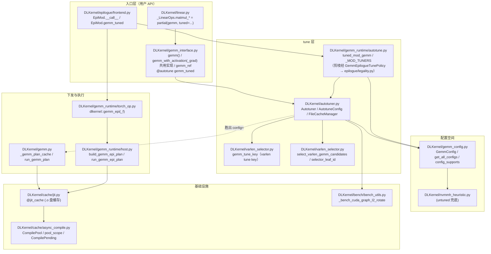
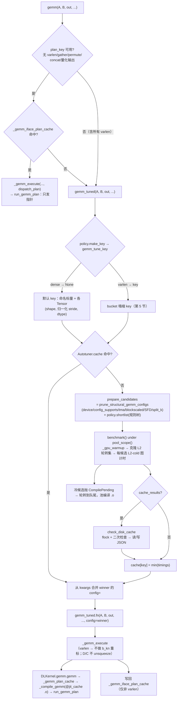
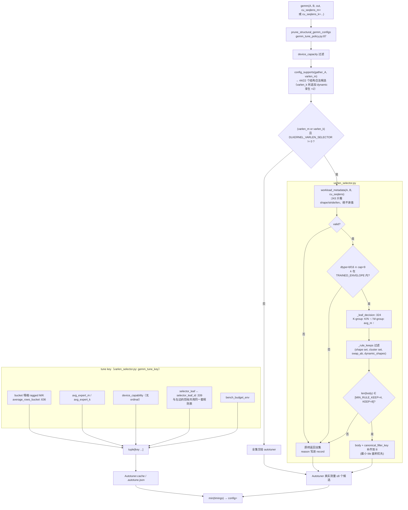

# DLKernel 本地 Autotuning（tune）子系统

> 阅读对象：需要改 tune 行为、加 tune 维度，或需要回答"这次调用为什么选了这个 kernel"的工程师。
> 范围：**进程内（local）autotuning**——候选枚举、评测、结果缓存、运行时查表。不含任何离线调参工具。
> 约定：所有结论都能在源码里对上。`path/to/file.py:LINE` 对应 2026-10-11 对 `feature/sm90-moe-clean-arch`（`4c9e800`）的全量核对；个别区间为"±数行"粒度。
> 与既有笔记的关系见 [docs/README.md](../README.md) 索引；缓存 / 并行编译的底层机制在 `docs/modules/caching_and_parallel_compilation.md`，本文不重复。

---

## 1. 概述与设计动机

### 1.1 tune 解决什么问题

DLKernel 的 GEMM 性能强依赖 `GemmConfig`（tile / cluster / pingpong / dynamic-persistent / swap_ab / split_k …）。同一个 `(M, N, K)` 在不同 tile 上能差出数倍。**哪个 tile 最快取决于形状、dtype、major、epilogue 形态与调度器开关**，没有稳定的解析解。

候选空间（`DLKernel/gemm_config.py:194`（SM80）、`:115`（SM90）、`:227`（SM100）、`:265`（SM120），由 `get_all_configs()`（`:294`）合并）：

| device_capacity | 原始候选数 | 说明 |
|---|---|---|
| 8 (SM80) | 32 | 8 组 `(tile_m, tile_n, num_warps)` × `tile_k∈{32,64}` × `swap_ab∈{T,F}` |
| 9 (SM90) | 44 | 11 组 `(tile_m, tile_n, pingpong)` × `cluster∈{(1,2),(2,1)}` × `swap_ab` |
| 10/11 (SM100) | 392 | 49 组 `(tile_m, tile_n, cluster)` × `swap_ab` × `is_dynamic_persistent` × `use_tma_gather` |
| 12 (SM120) | 18 | 9 组 `(tile_m,tile_n,pingpong)` × `swap_ab` |

`@autotune` 装饰器在**模块导入时**把全部 486 个 `AutotuneConfig` 建好（`DLKernel/gemm_interface.py:370-375`）。运行时再按 device / 布局 / epilogue 逐个剪枝。

tune 的目标一句话：**在结构合法的候选里，用真实测量选出最快的那个**，并把结果按"等价问题"缓存下来。

### 1.2 不 tune 时的默认路径

`gemm_tuned` 是唯一被装饰的函数；**不 tune = 直接调 `gemm_tuned.fn`**（`Autotuner.fn` 是未装饰的原始函数）：

- `gemm(..., tuned=False)` → `partial(gemm_tuned.fn, config=None)`（`DLKernel/gemm_interface.py:1194`）。
- `gemm_tuned.fn(..., config=<GemmConfig>)` → 显式钉死配置。基准脚本就这么用（`benchmarks/benchmark_gemm_autotuned.py:77`）。
- `config is None` 时内核侧自己挑默认（`DLKernel/gemm_interface.py:415-440` 起）：
  1. 纯 dense（无 varlen / gather / C / bias / add_to_output / 量化输出）→ `nvmmh_config()`，即 nvMatmulHeuristics 解析启发式（`DLKernel/gemm_interface.py:359-369`，实现 `DLKernel/nvmmh_heuristic.py`，可选依赖，失败返回 `None`）；
  2. 否则 → `blockscaled_default_config()`（`DLKernel/gemm_config.py:319`）或 `default_config()`（`:312`，per-cap 常量表 `:362`）。
- epilogue 侧同构：`mod.gemm(...)` 的 `config=` 钉死，或 `EpiMod._default_config`（`DLKernel/epilogue/frontend.py:1236`）。

要点：**启发式只是"没有测量结果时的兜底"**。tuner 跑过之后，上游总是把胜出的 `GemmConfig` 作为 `config=` 传进来；启发式分支随之跳过。

---

## 2. 架构分层与模块职责

### 2.1 分层依赖图



（实线＝调用/导入方向；虚线＝把选出的 `GemmConfig` 作为参数继续下发。）

### 2.2 模块职责

| 模块 | 职责 | 关键符号 |
|---|---|---|
| `DLKernel/autotuner.py` | 通用 autotuner：key 构造、剪枝、L2-cold 评测、内存表 + 磁盘 JSON 缓存、编译/评测重叠 | `Autotuner`(221)、`AutotuneConfig`(724)、`autotune()`(756)、`check_disk_cache`(413)、`FileCacheManager`(106) |
| `DLKernel/varlen_selector.py` | varlen tune key（`gemm_tune_key`：ragged 维塌缩成 bucket，dense 返回 `None`）+ varlen grouped（routed）场景的**候选剪枝规则树** | `gemm_tune_key`(688)、`average_rows_bucket`(636)、`_KEY_VERSION`(608)、`select_varlen_gemm_candidates`(465)、`selector_leaf_id`(339)、`K_GROUP_TREE`(88)、`M_GROUP_TREE`(116) |
| `DLKernel/gemm_config.py` | 配置空间与结构合法性 | `GemmConfig`(37)、`get_all_configs`(294)、`config_supports`(98)、`blockscaled_config_ok`(71)、`cta_tile_shape_m`(57) |
| `DLKernel/gemm_interface.py` | dense/varlen 公共入口 | `@autotune`(370)、`gemm_tuned`(375) |
| `DLKernel/gemm_tune_policy.py` | GEMM 结构剪枝（经 `GemmTunePolicy.prepare_candidates` 生效）+ split-K 展开/shortlist | `prune_structural_gemm_configs`(87)、`_expand_split_k_configs`(36)、`_shortlist_split_k_configs`(57) |
| `DLKernel/gemm_runtime/autotune.py` | `@gemm_epilogue` mod 的通用 tune | `tuned_mod_gemm`(375)、`_MOD_TUNERS`(335)、policy 剪枝 `prune_epilogue_configs`（`epilogue/legality.py:54`） |
| `DLKernel/cache/jit.py` | `.o` 持久缓存 + 跨进程 flock + 池交互 | `jit_cache`(239)、`_compute_source_fingerprint`(166) |
| `DLKernel/cache/async_compile.py` | CPU 编译池、defer-retry | `pool_scope`(547)、`CompilePending`(109) |
| `DLKernel/bench/bench_utils.py` | L2-cold CUDA-graph 评测协议 | `_bench_cuda_graph_l2_rotate`(69) |

---

## 3. GEMM tune（dense 路径）

### 3.1 tune key

tune key = "什么算同一个问题"。key 变了就重新 tune。

**dense 走 `Autotuner` 的默认 key**（`gemm_tuned` 传 `policy=VarlenGemmTunePolicy()`（`gemm_interface.py:373`），其 `make_key` 对 dense 返回默认 key，见 3.1.3）：

```python
# DLKernel/autotuner.py:697 _default_key（每次调用都跑，是热路径）
key = [kwargs[k] for k in self.keys if k in kwargs]
for arg in args:                       # 位置参数里的 Tensor
    if isinstance(arg, Tensor):
        key.append(tuple(arg.shape))
        key.append(tuple([s if s < 2 else 2 for s in arg.stride()]))
        key.append(arg.dtype)
for name, arg in kwargs.items():       # 具名 Tensor 参数（name ∈ 函数签名）
    if isinstance(arg, Tensor) and name in arg_name_set:
        key.append(tuple(arg.shape)); key.append(...stride...); key.append(arg.dtype)
key = tuple(key)
```

组成：

1. **命名标量维度**——`@autotune(key=[...])` 声明（`DLKernel/gemm_interface.py:371-372`）：`["dynamic_scheduler", "split_k", "split_k_mode", "bs_format_a", "bs_format_b"]`。
2. **每个 Tensor 的 `(shape, 归一化 stride, dtype)`**。
3. stride 归一化：`s if s < 2 else 2`——保留 0/1（广播、行/列主序、连续）语义，抹掉绝对 stride 数值（`DLKernel/varlen_selector.py:656` 的 `_reuse_profile` 是同一规则）。

**为什么这些必须进 key**：key 必须覆盖剪枝（`policy.prepare_candidates` / `shortlist`）读到的**一切**，因为**命中时不会再剪枝**（`DLKernel/autotuner.py:520` 的 `if key not in self.cache:` 才走剪枝管线）。剪枝读：device capacity、`A_idx` 是否存在、`cu_seqlens_m/k` 是否存在、`SFA`/`SFD`/`SFDCol` 是否存在、`split_k is None`、A/B 的 shape（`_expand_split_k_configs` 算 tile 数）与 dtype——全部被上面的 tensor 维度 + 命名标量覆盖。stride 决定 major，major 决定哪些 kernel 变体可编译，所以必须进。

**刻意不进 key 的**：`alpha` / `beta`（float 形式）、`bias` 的"有无"（作为 Tensor 传入时其 shape 仍在 key 里）、`add_to_output`、`rounding_mode`、`sr_seed`。理由：它们不改变**候选合法性**，只影响"选得好不好"；tune 只保证"在等价形状上选最快的合法候选"。**代价**见 9.1 第 2 条。

### 3.1.1 磁盘缓存还要额外吃下候选集本身

磁盘 key 是 `sha256(VERSION + str(tuning_key) + 每个候选的 str())`（`DLKernel/autotuner.py:419-421`，`VERSION` 即 `__version__`，`:29/:33`）。因此**增删改任何一个候选配置，会让所有 shape 的 tune JSON 全部失效**。这与 `AGENTS.md`「缓存稳定性不是设计约束」一致，但要有预期。

### 3.1.2 key 只在 kwargs 里找命名标量

`kwargs[k] for k in self.keys if k in kwargs`（`:700`）只扫关键字参数。调用方**位置传参** `dynamic_scheduler` / `split_k` / `split_k_mode` / `bs_format_a` / `bs_format_b` 时，这些维度**静默不进 key**。仓内调用（`DLKernel/gemm_interface.py:1194`、`:1268`、`:1337`）全部走关键字，所以当前不受影响；自己写调用时务必用关键字。

### 3.1.3 varlen 分支的 hook

`Autotuner.__call__` 每次先走 `self._policy_make_key(args, kwargs, default_key)`（`autotuner.py:507`）。policy 的 `make_key` 返回 `None`（dense）→ 用默认 key；返回 key（varlen bucket key）→ 用该 key，且 `policy.budget_override(key)`（`autotuner.py:291`；实现 `varlen_selector.py:902`）同时打开 bench 预算覆写开关——只有 routed/varlen 调用能读 `DLKERNEL_TUNE_WARMUP_MS` / `DLKERNEL_TUNE_TIMED_CALLS`（解析与夹取在 `autotuner.py:40-69`；非法取值直接 `ValueError`，不静默夹取）。这个耦合是有意的：dense 永远拿历史协议（200 ms / 200 次），varlen 才允许缩短冷启动。

### 3.2 候选配置空间

三层，逐层收窄：

**第一层：全量** `get_all_configs()`（`DLKernel/gemm_config.py:294`），导入期构造。

**第二层：结构剪枝** `prune_structural_gemm_configs`（`DLKernel/gemm_tune_policy.py:87`，经 `GemmTunePolicy.prepare_candidates` 在 `autotuner.py:523` 生效），按顺序：

1. `config.device_capacity == 本机 major`（`:94-96`）；
2. `config_supports(..., gather_A=..., varlen_m=...)`（`:99-103`，实现 `DLKernel/gemm_config.py:98`：gather/varlen 禁用 `swap_ab`；gather 还要求 `cluster_n==1`，SM90 上禁 `tile_n==208` 与 dynamic-persistent）；
3. `use_tma_gather` 只在 `gather_A` 且 SM100/110 时保留（`:104-105`）——这一条把 SM100 的 392 砍成 196；
4. blockscaled：`blockscaled_config_ok`（`:107`，实现 `gemm_config.py:71`：SF tmem 是 64-N 粒度、`tile_m∈{128,256}`、`cluster ≤ 4`、禁 swap_ab、`tile_k is None`）；
5. 量化输出（SFD/SFDCol）：`sfd_ok`（`:109-133`）；
6. **split-K 展开/筛选**：`_expand_split_k_configs`（`:36-52`）对存活候选追加 `split_k ∈ {2,4,8,16}` 变体（`2*s ≤ k_tiles`）；`_shortlist_split_k_configs`（`:57-84`，由 `GemmTunePolicy.shortlist` 调用）按 `ntiles < sm_count` 且 `ntiles*s ≤ 4*sm_count` 且 `2*s ≤ k_tiles` 留 split-K 变体。**模式不展开**（SERIAL/PARALLEL/SEPARATE 语义不同）；
7. **varlen grouped 规则树剪枝**：不在结构剪枝里——它在 `VarlenGemmTunePolicy.shortlist`（`varlen_selector.py:905`，由 `autotuner.py:526` 调用，见第 5 节）：仅当 `(varlen_m or varlen_k)` 且 `DLKERNEL_VARLEN_SELECTOR != "0"`，把集合再砍到 ≤ 8 个。

**第三层：epilogue mod 专用剪枝**：`GemmEpilogueTunePolicy.prepare_candidates` → `prune_epilogue_configs`（`DLKernel/epilogue/legality.py:54`），见第 6 节。

### 3.3 搜索与评测策略

**搜索 = 穷举**。没有搜索算法、没有贝叶斯/bandit：剪枝后的每个候选都测一遍，`min` 取胜（`DLKernel/autotuner.py:673`）。

**评测协议（默认，L2-cold）** `_bench_cuda_graph_l2_rotate`（`DLKernel/bench/bench_utils.py:69`）：

- 每次冷启动先 `_gpu_warmup()`：4096×4096 bf16 反复 matmul 200 ms，把 GPU 打到热稳定态，避免第一个候选被"还没降频"的 GPU 偏袒（`DLKernel/autotuner.py:133`）。
- 按形状克隆 `n_buffers` 份 `(args, kwargs)`（`_pick_l2_rotate_count`，`bench_utils.py:179`：让每轮输入字节数 ≥ 3×L2，上限 16、下限 4，并留一半空闲显存）。**同一份克隆集在所有候选间复用**（`DLKernel/autotuner.py:570-580`）。
- 3 次预跑 → 单次探针估时 → 按 `warmup_target_ms` 折算 warmup 次数（至少 50）→ **CUDA graph 捕获** `n_timed_calls` 次轮转调用 → 一次 `graph.replay()` 计时（`DLKernel/bench/bench_utils.py:112-148`）。轮转是为了打掉 L2 常驻带来的高估。
- 默认预算从被调用函数的默认值读取，防止两处漂移：`_DEFAULT_BENCH_WARMUP_MS = 200.0`、`_DEFAULT_BENCH_TIMED_CALLS = 200`（`DLKernel/autotuner.py:38-39`）。
- 返回 `(0.5, 0.2, 0.8)` 分位——实现返回**同一个标量重复 3 次**（`DLKernel/bench/bench_utils.py:153-155`），`timings[c][0]` 才是中位数。

**评测协议（回落）**：`_do_bench` 显式传入或存在 pre/post hook 时回落到 `triton.testing.do_bench(warmup=5, rep=25)`（`DLKernel/autotuner.py:313-315`、`:380-405`）。两套协议排序不同；回落时 `_tune_trace` 显式打印 `DLKERNEL_TUNE_L2_CLONE_UNAVAILABLE`（`:591`）。

**失败处理**：L2-cold 路径只吞 `(RuntimeError, MemoryError)`（smem 溢出 / 启动失败 / OOM）并给 `[inf, inf, inf]`（`:318` 起 `_bench`、except `:372`）；编程错误继续抛。回落 do_bench 路径吞一切异常。`inf` 永远不会赢，但会往 stderr 打一行 `n_failed/len` 汇总（`:650-653`）——**smem 溢出被静默掩盖是这里唯一的防线**。全部候选都失败时抛 `RuntimeError`，不缓存空冠军（`:668-673`）。

**预算覆写（只对 routed 生效）**：`DLKERNEL_TUNE_WARMUP_MS` 夹到 `[10, 2000]`、`DLKERNEL_TUNE_TIMED_CALLS` 夹到 `[16, 2000]`（`autotuner.py:40-69`）。

### 3.4 缓存与持久化

**内存表**：`Autotuner.cache: Dict[key, AutotuneConfig]`（`DLKernel/autotuner.py:246`），**无上限、无淘汰**，进程生命周期。命中即 `self.fn(*args, **kwargs, **winner.all_kwargs())`（`:693`）。

**磁盘（JSON）**——`check_disk_cache`（`:413-481`）：

```
cache_dir = $DLKERNEL_CACHE_DIR 或 ($DLKERNEL_HOME 或 ~)/.dlkernel/cache
FileCacheManager.key = base32(sha256(VERSION + str(tuning_key) + 各候选 str()))
file_name = f"{fn.__name__[:150]}.autotune.json"
内容 = {"key": str(tuning_key), "configs_timings": [[候选 str, [t50,t20,t80]], ...]}
```

- **是否启用**：`Autotuner.cache_results`，构造参数或环境变量 `DLKERNEL_CACHE_AUTOTUNING == "1"`（`:253-254`）。`gemm_tuned` 与 epi tuner 都显式 `cache_results=True`。
- **失效**：key 变；候选集变（字符串进 key）；`DLKernel.__version__` 变（`:29/:33`，进磁盘 key）；`DLKERNEL_FORCE_CACHE_UPDATE` 被设置（`:437`，`_env_flag` 解析）。
- **淘汰**：无。目录只增不减（`benchmarks/benchmark_gemm_autotuned.py:47` 的 `clear_caches()` 是唯一清理入口）。
- **冷启动拒绝**：`DLKERNEL_REQUIRE_TUNE_CACHE=1` 把冷 key 变成 `RuntimeError` 而不是 bench（`:446-452`）——用于断言"这一步的 shape 已在跑之前预热过"。
- **多进程**：`{file_name}.lock`（`fcntl.flock LOCK_EX`，`:463`）串行化昂贵测量，**锁内二次检查** `path = cache.get_file(file_name)` 后才 bench（`:458-468`），所以 N 个 rank 只有一个真的测。注意剪枝在**锁外**执行，每个 rank 都会跑一遍（便宜）。
- **命中时**：`load_cached` 用候选字符串反查 `AutotuneConfig`（`:427-434`），`bench_time = 0`。

**`jit_cache`（.o）是另一套**（`DLKernel/cache/jit.py`）：key = `sha256(fn.__qualname__, *args, **sorted(kwargs))`，路径 = `get_cache_path()/<源码指纹>/<sha>.o`。指纹含 `DLKernel` 全部 `.py` + cutlass/tvm_ffi 版本 + Python/CUDA/torch ABI + 归一化编译目标架构 + `_CACHE_FORMAT_VERSION`（`:166-192`）。两套缓存**独立失效**。

### 3.5 运行时选核路径

命中/未命中的分叉全在 `Autotuner.__call__`（`DLKernel/autotuner.py:500-694`）：

- `len(self.configs) <= 1` → 直接用 `configs[0]`，连 key 都不建（`:502`）。`self.configs` 是**导入期**的全量列表，不会因剪枝变短，所以对 `gemm_tuned` 恒为 `len>1`；但对 epi tuner 的注入式小空间（测试用）会真的走到。
- 命中 → 只付 key 构造 + 一次 dict 查找（`:697` 起 `_default_key` 刻意写成"不 merge、不 str()"的热路径）。
- 未命中 → `self.nargs = dict(zip(arg_names, args))`（**只装位置参数**）→ `prepare_candidates` → `shortlist` → `check_disk_cache`（若开）→ `benchmark()`。

**上游还有两层"计划缓存"，它们才是真正的热路径**：

1. `_gemm_iface_plan_cache`（`DLKernel/gemm_interface.py:889` 定义、key 构造 `:1010-1035`、命中 `:1036`）：把"校验 + config 解析（含 tune 胜者）+ 输出分配配方 + 下层 dispatch plan"整包缓存。命中后直接 `_gemm_execute(..., dispatch_plan=...)`，连 `tensor_key` 都不重算到 dispatch 层。**`cu_seqlens_m/k`、`A_idx`、`batch_idx_permute`、`concat_layout`、量化输出任一非空 → 直接跳过这个缓存**（`:1008-1016`），也就是**所有 varlen 调用都不走它**（见 4.4 节）。
2. `_gemm_plan_cache`（`DLKernel/gemm.py:261`，key `:461` 起）：kernel 级 plan（编译好的 fn + 静态 NamedTuple 模板），key 用 `tensor_key(t) = (dtype, shape, stride)`（`DLKernel/gemm_tvm_ffi_utils.py:428`）。

**epilogue 侧**对应 `EpiMod._call_cache`（`DLKernel/epilogue/frontend.py:445`）与 `EpiMod._plan_cache`（`:444`）。

### 3.6 一次 tuned GEMM 调用的完整流程图



冷启动 = **第一次见到的 key**：`_gpu_warmup` 200 ms + N 个候选的编译（与评测重叠）+ 每个候选约 200 ms 的 warmup 预算 + 一次图计时。SM100 的 dense 冷启动因此可能要面对 ~196 个候选，这是本子系统**最大的一笔固定开销**。

---

## 4. varlen（变长序列）路径

### 4.1 与 dense 的本质差异：为什么不能直接复用 dense 的 key / 选择逻辑

三条**结构性**差异，不是"参数不同"：

1. **形状不是常量，甚至不是 key 的合适粒度**。dense 的 `(M, N, K)` 一次定型；varlen 每次 step 的 routed 行数都变（MoE 每个 token 路由到的专家数不同）。用 dense 的 key（精确 shape）意味着**每个 token 数都是冷启动**——这正是 bucket 塌缩 key 写下的动机（`selector_leaf_id` docstring，`varlen_selector.py:349-356`）。
2. **真正的形状藏在 device 上**。`cu_seqlens_m/k` 是 GPU 张量，每段的长度要读回 host 才知道。`gemm_tune_key` 的不变量写得很明确：**key 构建在每次调用的 cache-hit 路径上，绝不能读 `cu_seqlens`（会同步）**；ragged 尺寸只能从**操作数的 shape** 推（`varlen_selector.py:748-780`：单遍扫参数，cache-hit 路径不读 `cu_seqlens` 值）。
3. **候选合法性不同**。`config_supports`（`DLKernel/gemm_config.py:98`）对 `varlen_m` / `gather_A` 禁用 `swap_ab`；`gemm_tuned` 路径上还有 blockscaled / varlen / SFD 的 `assert not config.swap_ab` 三连（`DLKernel/gemm_interface.py:450-459`）。核函数本身也含 varlen 专用参数（`VarlenArguments`，`DLKernel/varlen_utils.py:16`）。

另外一个直接的"路由差异"：**varlen 调用永远不进 `_gemm_iface_plan_cache`**（`DLKernel/gemm_interface.py:1008-1016` 的条件里显式排除 `cu_seqlens_*`）。所以 varlen 的"热路径"比 dense 短一层，heat 落在 `Autotuner.cache` + `_gemm_plan_cache`。

### 4.2 packed ragged 布局与 `varlen_utils.py`

- **`varlen_m`**：A 打包成 `(total_M, K)`（`gather_A` 时 A 是源表、`A_idx` 长度才是 total_M），输出 `(total_M, N)`；B 可以是共享 `(K,N)` 或专家主序 `(E,K,N)`（`DLKernel/gemm_interface.py:378-381` 参数注释、`DLKernel/varlen_selector.py:279-283` 布局契约）。
- **`varlen_k`**：B 打包成 `(total_K, N)`，输出保留 batch 维 `(L, M, N)`（`DLKernel/gemm_interface.py:380-381`）。这也是 `gemm_ref` 里两条参考实现的差别（`:1370` 起）。
- `DLKernel/varlen_utils.py`：device 侧的 `VarlenManager` 负责算每段的偏移与长度——`len_m/len_k`（`:95/:101`，直接从 `cu_seqlens` 相减）、`offset_batch_A/B/epi`（`:120-246`，含 ragged TMA 的 zero-fill 形式）、`offset_batch_AIdx`（`:159`）、`offset_batch_SFA/SFB`（`:169-205`，tile-aligned padding 偏移）。
- `VarlenManager.to_underlying_arguments` 断言**不支持同时给 `cu_seqlens_m` 和 `cu_seqlens_k`**（`:72`），与选择器里"两者都给 → invalid"是同一条约束（`DLKernel/varlen_selector.py:250-255`）。
- `sink_alloc_shape` 里 `num_seqs` 的存在（`DLKernel/epilogue/ops.py:1506`）是 varlen 的另一个投影：M-fold（`dim==1`）reduce 的部分和按**每序列的 tile 前缀**排布，行数上界是 `total_m // tile_m + num_seqs`。

### 4.3 tile scheduler 在 ragged 情况下怎么切 tile

`VarlenMTileScheduler`（`DLKernel/tile_scheduler.py:1257`）：

- **M 方向的 tile 数必须运行时扫描**：`_get_num_m_blocks`（`:1421`）用一次 warp 协作的 `cu_seqlens` 窗口扫描 + `warp_prefix_sum` 算出前 31 个问题的 cluster 累计数，再用 `vote_ballot_sync` + `popc` 定位当前 work_idx 属于哪个 batch。
- **官方 grid 形状是上界**：`get_grid_shape`（`:1350`）用 `(total_m + num_batch*(block_size-1)) // block_size`——注释写明这是"在只知道 `(total_m, L)` 时 `sum(ceil(len_i/block))` 的紧上界，由长度 ≡ 1 (mod block) 的对抗性分布取得"（`:1358-1361`）；grid 小于该值就会出现没有 work index 的 tile（CLC 下结果错误），多余槽位靠 `cancel_pending_tail` 变廉价。
- **性能关键路径**：`:1464-1477` 记录了"每序列窗口扫描"是长串行依赖链（gmem 加载、warp prefix-sum、ballot、shuffle）。CLC 下每次 steal 都要重跑：实测每次 steal 800–1100 cycle、端到端 3–9%（静态调度下该链可提前一个 tile 已知、仅暴露约 140 cycle/tile）。因此加了"当前 batch 窗口"缓存，只有 batch 真的变了才重扫。
- **N 方向**（varlen_k）的 ragged 在 contraction 维：由 TMA 的 zero-fill + MMA 跳过 pad block 处理，见 `docs/modules/varlen_blockscaled_sf_layout.md`（本文不重复）。
- `raster_order` / group 的 swizzle 见 5.6 节（它跟"专家分组"无关）。

### 4.4 varlen 的运行时缓存、失效与多进程交互

`tests/test_varlen_runtime_integration.py::test_varlen_custom_op_numerics_and_second_process_cache`（`:61`）是这条路径的验收测试。它把"缓存语义"钉死成三个断言（`:80-90`）：

1. 冷进程 stdout 必须出现 `DLKERNEL_TUNE_START ... configs=8` 与 `rule=<leaf>`——**tune 真的发生了，且规则树真的把它剪到 8 个**；
2. 第二次（新进程）必须出现 `DLKERNEL_TUNE_DISK_HIT`、**不能**出现 `DLKERNEL_TUNE_START`——磁盘缓存跨进程生效，且没有重新测量；
3. 两次的 `**/*.o` mtime 集合**逐字节相同**——第二次连编译都没发生，`.o` 直接复用。

对应的缓存结构（varlen 与 dense 共用）：

| 层 | 结构 | varlen 是否使用 | key 里的 varlen 维度 |
|---|---|---|---|
| L1 | `Autotuner.cache`（进程内） | ✅ | `gemm_tune_key` 的 bucket key |
| L2 | `*.autotune.json` + flock（跨进程/跨运行） | ✅ | 同上 + 版本 + 候选集 |
| L3 | `_gemm_plan_cache`（进程内，kernel plan） | ✅ | `tensor_key(cu_seqlens_m)` = **(dtype, shape, stride)**，**不含值** |
| L4 | `jit_cache` `.o`（跨进程/跨运行） | ✅ | 与形状无关（key 是编译期参数） |
| — | `_gemm_iface_plan_cache` | ❌ **显式跳过** | `gemm_interface.py:1008-1016` 排除 `cu_seqlens_*` |

**"值不进 key"是这套设计的关键**：`cu_seqlens` 只有**长度**（= 专家数 + 1）进 key，具体每段多长不进。所以同一 total tokens、不同分布的两个 step 会共享 L1/L3 的条目——L3 正确（内核运行时才读 `cu_seqlens`），L1 就是**故意的粗化**（代价：跑在真正最优候选上的概率下降）。

**失效条件**：任一维度变化 → 新 key → 新的冷启动与新的 JSON 文件。多进程交互与 dense 完全一致（`fcntl.flock` + 锁内二次检查 + 池内 dedupe）。跨进程**语义**上的额外风险是"值不进 key"，只能靠 key 里的 bucket 粒度控制误差。

### 4.5 与 `linear.py` / `gemm_runtime/*` 的调用关系

- **`DLKernel/linear.py` 完全不支持 varlen**：全文没有任何 `cu_seqlens` / `varlen` / `A_idx` 引用（已 grep 确认）。它通过 ops bundle 选择 tune 与否：`_LinearOps.matmul_fwd_fn = gemm`（tuned 默认）vs `_LinearUntunedOps.matmul_fwd_fn = partial(gemm, tuned=False)`（`DLKernel/linear.py:87`、`:99`）；反向同理（`:89-91`、`:108-110`）；gated/concat 变体再加 `concat_layout=`（`:115-125`）。
- **varlen 的入口是 `gemm` / `gemm_with_activation` / `gemm_with_activation_grad` 等直接调用**（`tests/test_linear_varlen_m.py` 名字里虽有 "linear"，实际调的是 `gemm(..., cu_seqlens_m=...)`）。
- **`gemm_runtime/*` 与 varlen 的关系**：`tuned_mod_gemm` 明确支持 varlen（`DLKernel/gemm_runtime/autotune.py:33`：`cu_seqlens_m`/`A_idx` 是顶层张量 kwarg，因此正常进 key、正常参与 L2 轮转克隆）。其 varlen key 同样走 bucket 塌缩——`_get_tuner` 传 `policy=GemmEpilogueTunePolicy`（`:365-368`），`make_key` 经 `gemm_tune_key` 塌缩（详见 9.2）。

### 4.6 测试覆盖（varlen_m vs varlen_k）

`tests/test_linear_varlen_m.py`：

- tma-gather 与 cp.async 一致性（`test_gemm_varlen_m_tma_gather_matches_cpasync`，`:98`；`num_groups=4`，随机 `seq_lens∈[96,320)`，`:105-106`）；
- 主测试 `test_gemm_varlen_m`（`:175`）：`num_groups∈{3,5}`、`n∈{1504,2048,4096}`、`k∈{736,1024,8192}`、`B_major∈{k,n}`、`gather_A`、`has_bias`、`alpha∈{1.0,1.7}` 且可为张量、`dynamic_scheduler`、`pre_allocate_out` 全组合；seq_len 取 `8192±1024`（`:191`）；
- 参考实现是 `gemm_ref`（fp32 逐段 `torch.mm`，`DLKernel/gemm_interface.py:1370`）。

`tests/test_linear_varlen_k.py`：

- `seq_lens` 用 CPU 生成后搬上卡（`:107-108`、`:185-191`），范围明显更小（`[2,6)*64`、`[50,300)`）；
- `dynamic_persistent` / `permute_batch` / `gather_A` / `alpha` / `num_groups∈{2,4}`（`:92-95`、`:156-172`）；
- 有专门的 tma-gather 对照测试（`:96`）。

**两条路线的差异（就代码而言）**：varlen_m 的 ragged 在 **M**（输出行、`A.shape[-2]`、`out.shape[-2]` 都变），输出**无 batch 维**；varlen_k 的 ragged 在 **contraction 维 K**（`B.shape[0]`），输出**保留 batch 维**，且 `A_idx` 的语义从"选行"变成"选列"（`gemm_ref` 的 `A[:, A_idx[...]]`）。varlen_m 在 blockscaled 下还要求 SFA 是 M-padded 的 `(1, ...)` 单批缓冲。

---

## 5. varlen grouped GEMM（routed / MoE 风格）

这一节讲**分组**这条线：`group_type` 的二分（K-group / M-group）、专属于它的候选剪枝规则树，以及它与 tune key 的耦合。

### 5.1 两条线：K-group 与 M-group

**`op` 是从布局推出来的，不是从语义**（`DLKernel/varlen_selector.py:243` 起 `workload_metadata`）：

| group_type | 触发条件 | `op` | 定义 |
|---|---|---|---|
| **M-group** | `cu_seqlens_m is not None` | `"nn"` / `"nt"` | `op = "nn" if B.stride(-1) == 1 else "nt"`（`:296`） |
| **K-group** | `cu_seqlens_k is not None` | `"tn"` | 恒定（`:306`） |

两个 group 的**专属分裂特征**（`_leaf_decision`，`:324`）：

- **K-group（`op=="tn"`）按 `K / N` 切**：`value = K / N`（`K` = `B.shape[0]` 即 total ragged K，`N` = `B.shape[-1]`），实现 `:328`。
- **M-group（`op∈{"nn","nt"}`）按 `avg_m` 切**：`value = routed_rows / expert_count`（每专家平均 routed 行数，**空专家也算进分母**，`:110-111`、`:329`）。

### 5.2 从算子元数据反推 workload（布局契约与拒绝分支）

`workload_metadata`（`DLKernel/varlen_selector.py:243`）只看 `shape` / `stride()` / `len(cu_seqlens)`，**从不读张量值**（文件头明确写了这是禁止 D2H 同步的设计约束）。逐条拒绝分支：

| 条件 | `reason` | 行 |
|---|---|---|
| 同时给 `cu_seqlens_m` 和 `cu_seqlens_k` | `both cu_seqlens_m and cu_seqlens_k were provided` | `:250-255` |
| 两个都没给（dense） | `not a varlen grouped GEMM` | `:256-257` |
| A 或 B 缺失 | `missing A or B operand` | `:258-259` |
| 给了 `A_idx`（gather_A） | `gather_A layout is not covered by the baseline study` | `:260-264` |
| `len(cu_seqlens) - 1 < 1` | `cu_seqlens must carry at least one expert segment` | `:267-273` |
| 操作数不是 2-D/value 张量 | `operands are not 2-D/value tensors` | `:275-277` |
| M-group：A 非 2-D，或 B 的 rank ∉ {2,3} | `M-group layout is outside the packed 2-D/3-D contract` | `:278-286` |
| M-group：B 是 3-D 且 `B.shape[0] != expert_count` | `expert-major B does not match cu_seqlens length` | `:284-292` |
| K-group：A 或 B 非 2-D | `K-group layout is outside the packed 2-D contract` | `:294-303` |

**无效 workload 的处理按调用点分层**：

- 选择器 `select_varlen_gemm_candidates` 里，invalid → **原样返回全集**（`:494-497`），只是 `record["fallback"] = bool(workload.get("varlen"))` 区分"dense 退出"与"varlen 但布局不覆盖"。
- `selector_leaf_id` 里，invalid → 返回 `FALLBACK_LEAF_ID = "fallback"`（`:77`、`:357-373`）。

### 5.3 规则树、leaf 求值顺序与 `TRAINED_ENVELOPE`

**树结构**（每个 group 两片叶子，自上而下第一个 `value <= leaf["upper"]` 命中即返回，`_leaf_decision`，`:324-335`）：

```python
K_GROUP_TREE                       # 特征 K / N
├─ "k-low"  upper = 79.072265625   # shapes ((128,256),(256,192)); clusters ((1,2),(2,1)); swap_ab=True
└─ "k-high" upper = +inf           # shapes ((192,128),(256,128),(256,192)); clusters ((1,2),); swap_ab=None（两者都行）
     + dynamic_shapes ((256,128),) # v7 增补：SM90 dynamic-persistent 实测胜者，仅此叶收录

M_GROUP_TREE                       # 特征 avg_m
├─ "m-low"  upper = 1194.6666666666667  # shapes ((128,160),(128,192),(128,208),(128,224),(128,256),(192,128),(256,128)); clusters ((1,2),); swap_ab=False
└─ "m-high" upper = +inf               # shapes ((128,192),(128,256),(192,128),(256,128),(256,160),(256,192),(256,208)); clusters ((1,2),); swap_ab=False
```

两个 cut 都落在**实测 gap 的中点**（规则表注释：K 组 gap 是 `78.1445 | 80.0`（`:91`）；M 组 gap 是 `1024.0 | 1365.33`（`:115/:119`））。设计意图是"没有 workload 贴着边界，小漂移不会把样本挪到另一片叶子"。

**dynamic-persistent 孪生（v7）**：`get_sm90_dynamic_varlen_configs()`（`DLKernel/gemm_config.py:163`）给出两个 `256×128 / cluster 1×2 / is_dynamic_persistent=True` 的配置（swap_ab 各一）。`VarlenGemmTunePolicy.prepare_candidates` 仅在 `cu_seqlens_k` 非空时把它们追加进候选池（`varlen_selector.py:886-893`）；规则树只经 k-high 叶的 `dynamic_shapes` 收录它们，其余叶子保持纯静态体。生产 768 专家 wgrad 形状上实测 -13.5% / -14.5%（上下投影），输出逐位一致。

**规则匹配**`_rule_keeps`（`:428-433`）：`(tile_m, tile_n)` 命中形状集 ∧ `(cluster_m, cluster_n)` 命中 cluster 集 ∧ (`rule["swap_ab"] is None` 或 `bool(fields["swap_ab"]) is bool(rule["swap_ab"])`)；`dynamic_shapes` 仅对 `is_dynamic_persistent=True` 的候选生效，且静态候选恒排在孪生之前。

**预算**：`KEEP = 8`（最多测 8 个候选）、`MIN_RULE_KEEP = 4`（`:68-69`）。若规则体落不到 `[4, 8]` → **整体回退全集**并记录 reason（`:539-554`）——这是对"内核网格变了、规则失配"的保险，宁可全测也不乱剪。

**`TRAINED_ENVELOPE`（`:151-167`）**——只在**实测过的包络内**（322 个基线用例的 min/max）才剪枝：

| group | ops | N | ragged K | expert_count |
|---|---|---|---|---|
| K-group | `("tn",)` | `(512, 7168)` | `(8, 4098424)` | `(32, 768)` |
| M-group | `("nt","nn")` | `(512, 7168)` | `(512, 7168)` | `(32, 768)` |

越界（`_coverage_reason`，`:199-217`）或 device 不是 SM90（`SUPPORTED_DEVICE_CAPABILITY = 9`，`:73`）或 dtype 不是 bf16（`SUPPORTED_DTYPE`，`:74`；`DTYPE_ALIASES` 接受 `torch.bfloat16`/`bf16`）→ **返回全集**：M-group 22 个、K-group 44 个（`tests/test_autotuner.py::test_large_sm90_varlen_out_of_coverage_keeps_the_structural_pool` 钉住）。

**"选择器从不选冠军"**（文件头 `:18-19`）：它只把候选集缩小；`shortlist` 之后仍由 autotuner 逐个真实测量再取 min。这是本设计最重要的边界：**规则树负责省时间，测量负责正确性**。

### 5.4 `canonical_filler_key`：为什么是"最小 tile 面积优先"

`canonical_filler_key`（`DLKernel/varlen_selector.py:400`）：

```python
return (tile_m * tile_n, tile_m, tile_n, cluster_m, cluster_n,
        int(bool(swap_ab)), tile_k, num_warps, int(bool(pingpong)))
```

动机写在 docstring 里：**"一个 routed 行数勉强盖满一个 tile 的 grouped GEMM 想要小形状"**。所以主键是 tile 面积从小到大；其后字段构成全序，保证结果可复现。当规则体不足 `KEEP` 时，用同一个 key 排序的**非规则体候选**补齐（`:556-558`）。这个顺序是**离线研究打过分的冻结常量**，不要随手改。

`select_varlen_gemm_candidates` 的返回值保证（`:477-482` docstring）：**永远是入参的子列表、永不为空、顺序只依赖 `canonical_filler_key`（不依赖调用方的入参顺序）**——`test_result_is_independent_of_input_order`（`tests/test_varlen_selector.py:342`）用乱序入参验证了这一点。

### 5.5 tune key 的 bucket 塌缩，以及它与选择器的语义耦合

`gemm_tune_key`（`varlen_selector.py:688`）只在 **`cu_seqlens_m` 或 `cu_seqlens_k` 非空**时接管（`:739-741`），否则返回 `None`（dense 保持默认 key）。

**塌缩规则**（`average_rows_bucket`，`varlen_selector.py:636`）：

```
avg = ceil(rows / experts)            # 注意是 ceil，不是浮点除；experts <= 0 返回 -1
bucket = 32          if avg <= 32     # _MIN_AVERAGE_ROWS
       = 最小 >= avg 的 2 的幂
ragged 维的 key 值 = bucket * max(experts, 1)   # _ragged_dimension（:650）
```

`_MIN_AVERAGE_ROWS = 32` 的理由写在注释里："实测 MoE 分片从每专家 32 routed 行起步，更细的下界只会切碎 key 空间"（`varlen_selector.py:601`）。

**key 的完整内容**（顺序即代码顺序）：

1. `_KEY_VERSION = "gemm_token_bucket_v5"`（`varlen_selector.py:608`）——版本号一升就刻意作废旧缓存；
2. **所有非操作数标量/枚举**，按**参数名的字典序**（`_key_layout`，`:626`，注释说明这是为了保持 v1 `sorted()` 的字节级一致）；
3. `("avg_expert_m", bucket)` / `("avg_expert_k", bucket)`（`:792-794`）；
4. `("device_capability", (major, minor))`；取不到时退化为 `("device_type", device.type)`——**device ordinal 被刻意排除**，理由写在 `:803-805`：`CUDA_VISIBLE_DEVICES` 重映射不该让等价硬件分裂出不同的冠军；
5. 每个命名张量的 `(name, 塌缩后 shape, 归一化 stride, dtype)`。具体塌缩哪一维：`out`/`C`/`D`（epilogue 输出）的 `[-2]`、`A`（无 gather）的 `[-2]`、`A`（varlen_k 或无 gather）的 `[-1]`、`B` 的 `[0]`、`A_idx` 的 `[-1]`、每 routed 行向量（如 `mColVecBroadcast`）的 `[-1]`；opaque 名单（reduce sink、`ta__*`）只进 dtype；
6. `("selector_leaf", selector_leaf_id(...))`（`:842-846`）；
7. `("bench_budget_env", DLKERNEL_TUNE_WARMUP_MS, DLKERNEL_TUNE_TIMED_CALLS)`（`:857-861`）——协议换了就不许复用旧冠军。

**哪些进、哪些刻意不进——理由与代价**：

| 维度 | 进 key？ | 理由 / 代价 |
|---|---|---|
| ragged M / ragged K 的**具体值** | ❌（塌缩成 per-expert 的 2 的幂 bucket） | 这是本设计存在的全部理由。代价：同一 bucket 内最多 **2×** 的尺寸范围共享同一个冠军 |
| **每专家平均行数**（`avg_expert_m/k`） | ✅（作为 bucket 值） | 防止"总行数同桶、但每专家行数跨桶"的两个 workload 混用（`test_gemm_token_bucket_keeps_average_expert_rows_bucket`） |
| 专家数 | ✅（隐含在 `cu_seqlens` 的 shape 里 + bucket 乘子） | 专家数直接决定每专家的平均行数 |
| **每段的实际长度分布** | ❌ | 读它需要 D2H 同步；`gemm_tune_key` 把它列为硬不变量（`varlen_selector.py:748-780`） |
| dtype / stride（归一化） | ✅ | major 决定 kernel 变体 |
| `device_capability` | ✅ | 不同 arch 候选集不同 |
| device ordinal | ❌（刻意） | `CUDA_VISIBLE_DEVICES` 重映射不该分裂冠军 |
| `A_idx` / gather 标志 | ✅（作为张量 & 标量） | 改变 A 的解释方式 |
| `selector_leaf` | ✅ | **见下** |
| bench 预算 env | ✅ | 不同协议测出的冠军不可比 |
| `SFD` / `SFDCol` 等具名张量 | ✅（shape/dtype） | 输出量化布局不同（`test_gemm_token_bucket_keeps_quantized_output_scale_shape`） |

**`selector_leaf` 进 key——这是 key 与选择器之间的语义耦合，必须理解**：

K-group 的 cut（79.07）与 M-group 的 cut（1194.67）**都落在 2 的幂 bucket 区间内部**。举个具体例子（`test_gemm_token_bucket_separates_same_bucket_across_selector_leaves`）：64 个专家、`N=2048`，total K = 160000 与 162000——per-expert 平均 2500 与 2531.25，**都落进 4096 这个 bucket**（同一 bucket），但 `K/N` = 78.125 与 79.1015625 **分属 `k-low` / `k-high` 两片叶子**。

如果 key 里只有 bucket，先到的那个 workload 会给**整个 bucket** 定下冠军，而它的最优 tile 集合来自另一片叶子——这正是 `selector_leaf_id` docstring 写下的动机（`varlen_selector.py:349-356`）："两个共享 bucket 的 workload 若落在不同叶子，应该各自 tune，而不是让先到的那个替整个 bucket 决定冠军"。

代价：**key 空间变大**（同一个 bucket 至少分裂成 leaf 数份），跨 step 的命中率下降；换来的是一致性。这是有意为之的权衡，不是 bug。

`selector_leaf_id` 与 `select_varlen_gemm_candidates` **共用同一套规则表和环境判定**（`varlen_selector.py:339` 与 `:465` 走同一个 `workload_metadata` / `_coverage_reason` / `_leaf_decision`），所以 key 和剪枝**不会各说各话**。`selector_leaf_id` 还额外接受 `selector_enabled`（`DLKERNEL_VARLEN_SELECTOR != "0"`，`varlen_selector.py:851`），关掉开关时所有 workload 都退化成 `"fallback"` 叶子——`test_gemm_token_key_tracks_selector_switch_and_bench_budget` 把"开关进 key"和"预算进 key"都钉住了。

### 5.6 `num_groups_regular` / `group_id` 到底是什么（避免误读）

`DLKernel/tile_scheduler.py` 里的 `group_id` / `num_groups_regular` / `id_in_group` 是 **CTA raster swizzle（L2 复用）** 的分组，**与 MoE 的专家分组无关**。证据：

- `TileScheduler.Params` 里它们由 `ncluster_fast` / `group_size` 算出（`:326-328`），`_swizzle_cta` 用它们把 cluster 线性 id 映射成 `(cid_m, cid_n)`，并做蛇形（serpentine）反转（`:494-521`）；
- `TriangularTileScheduler` 用它做三角 swizzle（`:1067` 起）；
- 头注释就是 `# CTA Swizzle to promote L2 data reuse`（`:497`）。

**专家分组**在 varlen_m 里由 `VarlenMTileScheduler` 通过 `cu_seqlens_m` 承担（4.3 节）：`_get_num_m_blocks`（`:1421`）用 `cu_seqlens_m[b]`/`[b+1]` 求 `seqlen = next - cur`，再 `ceil_div(seqlen, block_size)`。K-group（`varlen_k`）不走这个 scheduler 的 M 扫描（ragged 在 K），ragged 由 TMA zero-fill + MMA 跳过 pad block 处理。

### 5.7 grouped 场景流程图



### 5.8 测试覆盖

`tests/test_varlen_selector.py`（全文自包含，且明确声明"实测命中率属于离线研究证据，不是 CI 测试"，`:12-13`）：

- `test_rule_table_is_the_validated_tree`（`:122`）：规则表就是被验证过的那棵树——含 `low["upper"]` 必须落在实测 gap 内、`keep == 8`、`device_capability == 9`、`dtype == bfloat16`；
- `test_m_group_tree_switches_leaf_at_the_studied_average`（`:151`）/ `test_k_group_tree_switches_leaf_at_the_studied_ratio`（`:169`）：两个组各自在 cut 两侧切换叶子；
- `test_four_leaves_return_the_frozen_candidate_sets`（`:250`）：四片叶子的候选集是逐个钉死的冻结集合（含 tile/cluster/swap_ab 五元组）；
- `test_k_high_dynamic_twins_come_after_the_static_body`（`:256`）：dynamic 孪生只进 k-high，且排在静态体之后；
- `test_leaf_boundaries_and_coverage_are_self_contained`（`:313`）：叶子边界与覆盖率边界（`161940 → k-low`、`161941 → k-high`、越界 → fallback）；
- `test_k_group_low_leaf_is_padded_with_the_canonical_order`（`:319`）：低叶子不足 8 个时用 `canonical_filler_key` 以 `128x128` 补齐；
- `test_selector_never_invents_candidates_and_never_empties_the_set`（`:334`）：永不创造候选、永不为空、`≤ KEEP`；
- `test_result_is_independent_of_input_order`（`:342`）：结果与入参顺序无关；
- `test_dense_and_uncovered_layouts_return_the_pool_unchanged`（`:361`）与 `test_unproven_layouts_fall_back_without_reading_tensor_values`（`:393`）：dense / gather / 双 cu_seqlens / 未验证布局原样返回，且只读元数据（用一个对 `item/tolist/cpu` 等直接抛错的替身张量）；
- `test_selector_leaf_id_uses_metadata_only`（`:419`）、`test_unsupported_device_dtype_and_out_of_envelope_fall_back`（`:451`）：leaf id 只用元数据；越界 dtype/device/N/专家数回全集。

`tests/test_autotuner.py` 额外覆盖：bucket 塌缩把 gather 的 index 长度算进行数（`test_gemm_token_bucket_buckets_gather_indices_with_rows`）、EP8 不碰撞、varlen_k 保留静态 N、SFD 形状进 key、bucket 与叶子的跨叶分裂、capability 而非 ordinal、开关与预算进 key、省略参数与显式默认值归一（`:49-341` 的 `test_gemm_token_*` 系列）、选择器端到端剪到 8 个 + kill switch + 越界返回全集 + gather 仍走结构过滤 + dynamic 孪生（`test_large_sm90_varlen_*` 系列，`:343-500`）。

`tests/test_varlen_runtime_integration.py`：见 4.4 节（跨进程 + 磁盘 + 已编译对象的复用）。

---

## 6. Epilogue autotune 与 GEMM autotune 的关系与分工

**同一个引擎，不同的调用面**。`DLKernel/gemm_runtime/autotune.py` 直接复用 `Autotuner`（文件头 `:10-41` 写明：CUDA-graph L2-cold bench、async-compile 池重叠、`$DLKERNEL_CACHE_DIR` 下的 JSON 缓存全都一样），差别在**输入面**和**剪枝规则**：

| | GEMM autotune（`gemm_interface`） | Epilogue autotune（`gemm_runtime/autotune`） |
|---|---|---|
| 被装饰的函数 | `gemm_tuned`（模块级单例） | 每个 `EpiMod` 现造一个闭包 `fn`（`_make_tuned_fn`，`:203`）；tuner 存在 `_MOD_TUNERS`（`:335`） |
| tuner 注册键 | —（全局一个） | `(mod.semantic_digest, epi_names, has_c, device_major, transform digest, ta_names)`（`:339-346`） |
| key 维度 | 默认 key + `policy.make_key → gemm_tune_key` | `key=["mod_digest","b_kn","dynamic_scheduler","concat_layout","bs_format_a","bs_format_b","transform_digest"]`（`:355-364`）+ 顶层张量 kwarg 的元数据 |
| 剪枝 | `prune_structural_gemm_configs`（`gemm_tune_policy.py:87`，经 `GemmTunePolicy.prepare_candidates`） | `GemmEpilogueTunePolicy.prepare_candidates` → `prune_epilogue_configs`（`epilogue/legality.py:54`） |
| 磁盘缓存 | `cache_results=True` | `cache_results=True`（`:369`），文件名含 mod digest（`fn.__name__ = f"mod_{mod._ident}"`，`:305`） |
| varlen key | bucket 塌缩（第 5 节） | 同样 bucket 塌缩：`GemmEpilogueTunePolicy.make_key → gemm_tune_key`（见 9.2） |

**为什么 mod_digest 必须进 key**：`@gemm_epilogue` 生成的类身份由 `semantic_digest` 决定（`DLKernel/epilogue/frontend.py:441`），改一行函数体就会得到新的 digest；key 里带上它，**内存与磁盘两级 tune 缓存同时失效**（`tests/test_epi_autotune.py::test_mod_digest_in_disk_key` 断言两个 mod 的 digest 不同、tuner 不共享）。

**epilogue 特有的机制**（都在 `DLKernel/gemm_runtime/autotune.py` 的模块 docstring `:10-41` 里）：

1. **`epi_args` 必须扁平化成显式 kwargs**，wrapper 再伪造一个 `__signature__`（`:306-334`）。原因：`Autotuner` 从**顶层具名张量 kwarg** 推导 key 和 L2 轮转克隆集；把一个 dict 传进去既不会进 key 也不会被克隆，所有候选会共用同一块缓冲。
2. **reduce-sink buffer 按 sweep 的最坏情况分配**（`sink_arg_shapes`，`:114-141`：取候选空间里最小的 `tile_n` 与最小的 `cta_tile_shape_m`，因为"cdiv 对 tile 单调"）。调用方自带的 sink 若小于最坏情况，在 tune/查缓存之前就被 `_validate_full_sink_buffers`（`:142-178`，含 varlen 的 `num_seqs` 行）拒绝。wrapper 在每个候选上切片（`_slice_sinks`，`:181-202`），胜出切片通过 `TunedModGemm.sinks` 返回。`EpiOp.sink_alloc_shape` 是这条规则的**唯一声明处**（`DLKernel/epilogue/ops.py:1506-1524`），校验 / 分配 / fake / tune 全都调它。
3. **`mod.gemm` 的校验错误被重包成 `RuntimeError`**（`:301-304`），否则一个剪枝漏掉的候选会中断整个 sweep（bench 只把 `RuntimeError`/`MemoryError` 映射成 `inf`）。
4. **标量 epi 参数不进 key**（docstring `:26-29`），理由：tile 选择对**标量值**不敏感，且 `mod.gemm` 在真实调用时会按元数据重新 plan。
5. `dynamic_scheduler=True` 会强制**每个候选**都用 dynamic-persistent 调度（`:253`）；`swap_ab` 只在 element-mode 且无 sink 的 mod 上通过 swap-at-trace 生效（docstring `:33-34` 与 sweep `:258-259`）；`split_k` **尚未支持**（`:43`）。

**eager 入口**（`DLKernel/epilogue/frontend.py`）：`use_tuner` 的守卫是 `tuned and config is None and rounding_mode == RN and epi_key_overrides is None and not add_to_output`（`:1588-1595`）——SR / 显式 key 覆盖 / reduce-add D 走非 tune 路径。sink 形状按 `(lead[-1], n, l, device, num_seqs)` 缓存在 `self._sink_shape_cache`（`:1602-1612`），因为 `sink_arg_shapes` 会遍历整个候选空间、且在热路径上。

**torch.compile 路线不 tune**：`__call__` 在 `torch.compiler.is_compiling()` 时直接走 `compile_call`（`:1466-1478`）；且对带 sink 的 mod 强制 `cfg = default_config(A.device); tuned = False`（`DLKernel/gemm_runtime/torch_op.py:247-253`，"partials 由 graph 分配，tiling 必须在这里定死"）。不带 sink 时 op body 在**执行期**用 `tuned=m["tuned"]` 调回 `__call__`（`torch_op.py:124` 起），等价于在第一次真实执行时补一次 tune。

---

## 7. 配置开关与环境变量

| 变量 | 默认 | 作用 | 定位 |
|---|---|---|---|
| `DLKERNEL_CACHE_AUTOTUNING` | unset | `=1` 时让 `cache_results=False` 的 tuner 也写盘 | `autotuner.py:253-254` |
| `DLKERNEL_PRINT_AUTOTUNING` | unset | `=1` 打印每个候选耗时与最终选择 | `autotuner.py:319`、`:564`、`:655/:687` |
| `DLKERNEL_FORCE_CACHE_UPDATE` | unset | 真值（如 `=1`）忽略磁盘结果重测；`=0` 不触发 | `autotuner.py:437` |
| `DLKERNEL_REQUIRE_TUNE_CACHE` | unset | `=1` 时冷 key 直接 `RuntimeError`，不 bench | `autotuner.py:446-452` |
| `DLKERNEL_DEBUG_TUNE` | unset | `=1` 输出 `DLKERNEL_TUNE_START/DISK_HIT/DISK_MISS/END/L2_CLONE_UNAVAILABLE`；同时打开选择器日志 | `autotuner.py:81`（`_tune_trace`）；`varlen_selector.py:445-456` |
| `DLKERNEL_TUNE_WARMUP_MS` | 200 | 仅 routed（policy 返回 bucket key）生效；夹到 `[10, 2000]`，非法值报错 | `autotuner.py:40-69` |
| `DLKERNEL_TUNE_TIMED_CALLS` | 200 | 同上；夹到 `[16, 2000]`，非法值报错 | `autotuner.py:40-69` |
| `DLKERNEL_VARLEN_SELECTOR` | `1` | `=0` 关闭规则树剪枝（回全集）；**同时改变 tune key** | `varlen_selector.py:851、:916` |
| `DLKERNEL_VARLEN_SELECTOR_LOG` | unset | 追加 JSONL 记录（`selector_version/applied/fallback/rule/...`） | `varlen_selector.py:445-463` |
| `DLKERNEL_CACHE_DIR` | `.o`：`/tmp/$USER/dlkernel_cache`；winner：`~/.dlkernel/cache` | 同时覆盖 `.o` 根（`cache.get_cache_path()`）与 winner 根（`FileCacheManager`）；没有独立的 artifact 旋钮 | `cache/__init__.py:38-39`；`autotuner.py:102-110` |
| `DLKERNEL_CACHE_ENABLED` | `1` | `=0` 关闭 `.o` 磁盘缓存（内存缓存仍在）；**不影响 tune JSON** | `cache/__init__.py:38`；`cache/jit.py:273-287` |
| `DLKERNEL_HOME` | `~` | 决定 tune JSON 的默认根 | `autotuner.py:99-104` |
| `DLKERNEL_ARCH` | 物理 GPU | 覆盖**分派**架构（CPU-only 编译）；进 `.o` 指纹 | `cute_dsl_utils.py:97-139`；`cache/jit.py:176` |
| `DLKERNEL_COMPILE_WORKERS` | 8 | 共享编译池大小 | `cache/async_compile.py:342` |
| `DLKERNEL_ASYNC_COMPILE_START` | `forkserver` | 改 `spawn` 关掉 sidecar | `cache/async_compile.py:312` |

注意：`DLKERNEL_CACHE_AUTOTUNING` 要求精确等于 `"1"`；`DLKERNEL_FORCE_CACHE_UPDATE` 使用布尔解析（`autotuner.py:73-78`），`"0"`、`"false"`、`"no"`、`"off"` 都不会触发重测。

---

## 8. 测试策略与覆盖

**覆盖到的**（都能对上代码）：

- **key 语义**：`tests/test_autotuner.py:49-341` 的 `test_gemm_token_*` 系列——bucket 塌缩、gather 行数、静态 N 保留、SFD 形状、跨叶分裂、capability vs ordinal、开关/预算进 key、默认值归一化、dense 退出；预算覆写门控与非法 env 拒绝（`test_bench_budget_*`，`:654-735`）。
- **剪枝语义**：`tests/test_autotuner.py::test_large_sm90_varlen_*`（`:343-500`）；`tests/test_varlen_selector.py`（全树冻结 + dynamic 孪生 + 边界 + 顺序无关 + 只读元数据）。
- **剪枝不会越权**：`test_selector_never_invents_candidates_and_never_empties_the_set`、`test_result_is_independent_of_input_order`（子集、非空、顺序无关）。
- **policy 管线契约**：`test_autotuner_policy_hooks_run_in_order`、`test_autotuner_policy_rejects_empty_or_duplicate_candidates`（`:882-935`）；split-K 合法性与 shortlist 分离（`:937`）。
- **编译/评测重叠**：`test_autotune_bench_loop_defers_and_retries`（`:502`，`CompilePending` 轮转 + 重试 + 最终每个候选恰好测一次 + 计时不被破坏）；`test_autotune_wedged_pool_falls_back_in_process`（`:564`，卡死的池子超时后转 in-process，sweep 一定终止）。
- **缓存策略**：`DLKERNEL_REQUIRE_TUNE_CACHE=1` 对 varlen 与 dense 都拒绝（`:787-838`）；未设置时正常 tune；全失败 sweep 不写缓存（`:840`）。
- **磁盘/跨进程**：`tests/test_varlen_runtime_integration.py`（4.4 节）；`tests/test_cache.py`（`.o` 指纹、锁串行化、静态 flag 的导入顺序）。
- **epilogue tune**：`tests/test_epi_autotune.py`——胜者输出与显式 `mod.gemm` **逐位相等**（`test_tuned_mod_gemm_matches_explicit`）、二次调用不重测（`test_tuned_mod_gemm_cache_hit`）、剪枝规则（`test_prune_rules`）、sink 契约（部分 buffer 拒绝、per-CTA tile 切片、varlen num_seqs 计容）、mod digest 进磁盘 key、value/W4 transform 走 tune、bucket 内 varlen 复用冠军。

**没覆盖到的**（明确写出来）：

- **没有** `_gemm_iface_plan_cache` / `_gemm_plan_cache` / `EpiMod._call_cache` 的命中-等价性测试（例如"命中路径与慢路径产生同一结果"）。
- **没有**对"同一 bucket 内不同 ragged 尺寸共享冠军"的**性能**回归——这正是塌缩的代价，但只在离线研究里量化过。
- **没有** bench 协议本身的数值稳定性测试（噪声、时钟漂移、共享节点）——`AGENTS.md` 把它们列为 benchmark 纪律，不是 CI 断言。
- **没有** `DLKERNEL_FORCE_CACHE_UPDATE` / `DLKERNEL_PRINT_AUTOTUNING` 的行为测试。
- 选择器的**硬件**测试只在 `tests/test_varlen_runtime_integration.py` 里，且 `capability[0] != 9` 时 skip。

**怎么加一个 tune 维度 / 候选配置**：见第 10 节。

---

## 9. 已知限制与坑

### 9.1 代码与文档/预期不一致（按风险排序）

1. **`autotune()` 的 `cache_results` 默认值与 docstring 矛盾。** docstring 写 `Defaults to False.`（`DLKernel/autotuner.py:777`），签名默认是 `True`（`:757`），`Autotuner.__init__` 的签名默认也是 `False`（`:229`）但在装饰器路径上恒定被覆盖为 `True`（`:253-254`）。**实际后果**：`gemm_tuned` 与 epi tuner 默认就会写盘，`DLKERNEL_CACHE_AUTOTUNING` 对它们毫无作用。这是**文档 bug**（行为本身是有意的：缓存结果显然是期望行为）。

2. **dense key 不含 `rounding_mode` / `add_to_output` / `sr_seed` / `alpha` / `beta`。** 它们不影响候选**合法性**（剪枝不读它们），所以不会选到非法 kernel；但它们确实会影响**谁最快**，且 `_gemm_iface_plan_cache` 的 key（`gemm_interface.py:1030`、`:1033-1034`）**是含** `rounding_mode` 与 `alpha`/`sr_seed` 模式的。也就是说同一形状下 RN 与 RS 会共用同一个 tune 冠军，而两者的计划缓存却是分开的。属于**已知的粗化**，不是崩溃级问题。

3. **位置传参的命名标量维度不进 key。** 见 3.1.2（`_default_key` 只扫 kwargs，`autotuner.py:700` 起）。当前仓内调用全用关键字，但这是一个静默失效点。

4. **`_bench` L2-cold 路径的 `(RuntimeError, MemoryError)` 是唯一的失败屏障。** `_make_tuned_fn` 特意把 `ValueError/TypeError/AssertionError` 重包成 `RuntimeError`（`gemm_runtime/autotune.py:301-304`），但 `prune_structural_gemm_configs` / `prune_epilogue_configs` 路径没有这层包装——若将来某条剪枝规则漏掉一个会在**编译期**抛 `ValueError` 的候选，整个 sweep 会中断而不是记为 `inf`。

5. **`DLKERNEL_CACHE_ENABLED=0` 不会关掉 tune JSON。** 它只控制 `jit_cache` 的磁盘侧（`cache/jit.py:273-287`），且**不清**内存缓存。按 `AGENTS.md` 的 CuTe-DSL 注意事项，做 `const_expr` 消融实验时如果忘了它，会得到"消融无差异"的假结论——这是仓库已经踩过的坑（同一条注意事项）。tune 侧同理：改 `GemmConfig` 语义但没改 key 时，会命中旧 JSON。

### 9.2 与选择器 / bucket 边界相关的**潜在错配**（有证据的结论）

- **cut 落在 2 的幂 bucket 区间内部，是"刻意耦合"而非错配**：K 组 cut 79.07 与 M 组 cut 1194.67 都不在 bucket 边界上；bucket 只按 2 的幂切（`average_rows_bucket`，`varlen_selector.py:636-647`）。因此同一个 bucket 里**必然**可能同时存在两片叶子的 workload，`selector_leaf` 进 key 正是为此（`selector_leaf_id` docstring，`varlen_selector.py:349-356`；测试 `test_gemm_token_bucket_separates_same_bucket_across_selector_leaves`）。
- **两个函数用了不同的除法**：bucket 用 `ceil(rows/experts)`（`:640`），叶子用精确浮点 `routed_rows / expert_count`（`:329`）。当 `rows` 是 `experts` 的整数倍时二者相等；否则 ceil 大一点点，**只会影响是否跨过 bucket 的 2 的幂边界**，不会让 bucket 与叶子的判定互相污染（叶子完全不用 bucket）。这是**可接受的不一致**；但要改 bucket 语义，必须同时确认叶子不受影响。
- **epilogue 入口同样拿到 bucket 塌缩**：`tuned_mod_gemm`（epilogue 路径）与普通 GEMM 共用同一机制。`_get_tuner` 传入 `policy=GemmEpilogueTunePolicy(mod, transform_a)`（`gemm_runtime/autotune.py:365-368`）；`Autotuner.__call__` 每次先走 `policy.make_key`（`autotuner.py:507`）；`GemmEpilogueTunePolicy` 继承 `VarlenGemmTunePolicy`，`bind_signature` 检测到签名含 `cu_seqlens_m/k` 时置 `_varlen_params`（`varlen_selector.py:880-883`），`make_key` 据此调用 `gemm_tune_key`，并把 epilogue 输出/scratch 按 `ragged_m_out_names`（默认含 `out/C/D` 与声明输出）和 `ta__*` 等 opaque 名单处理（`gemm_epilogue_tune_policy.py:50-62`）。静态 `key=` 只在**无** varlen 参数时才直接成为最终 key。带 epilogue 的 routed MoE GEMM（`cu_seqlens_m` 经 `tuned_mod_gemm` 进入）同样命中 bucket key，不会因 routed 行数变化而冷启动。
- **`MIN_RULE_KEEP`/`KEEP` 与候选网格强绑定**：规则表是照着 SM90 的 tile 网格冻结的（`varlen_selector.py:539-554` 的区间检查）。**任何对 `_get_sm90_configs` 的增删都可能让某片叶子的规则体超出 `[4, 8]` → 该 workload 整体回退全集**（不会出错，只是变慢）。`test_four_leaves_return_the_frozen_candidate_sets` 会把这种改动直接测挂，这是有意的护栏。

### 9.3 缓存 / 生命周期

- **所有内存表都无上限、无淘汰**：`Autotuner.cache`（`autotuner.py:246`）、`_gemm_plan_cache`（`gemm.py:261`，注释自述"grows with distinct (shape, stride, dtype, flag) combinations, like the autotuner cache"）、`_gemm_iface_plan_cache`（`gemm_interface.py:889`）、`_MOD_TUNERS`（`gemm_runtime/autotune.py:335`）、`EpiMod._call_cache` / `_plan_cache` / `_sink_shape_cache`。服务化场景下按 shape 数线性增长。
- **tune JSON 与 `.o` 是两套独立的失效域**：改 `DLKernel/__init__.py` 的 `__version__` 只废 tune JSON；改任何 `DLKernel/*.py` 只废 `.o`（源码指纹）。升级时**两者都可能只废一半**，删缓存要删两个目录（`benchmarks/benchmark_gemm_autotuned.py:47-59` 就是这么做的）。
- **`jit_cache` 的锁超时是"降级不报错"**：所有锁获取都显式传 `timeout=LOCK_TIMEOUT=60` s（`cache/jit.py:44`、`:320`、`:360`、`:390`）。超时后回落 in-process 编译且**不写盘**（`cache/jit.py:390-411`），只发一条 `RuntimeWarning`。高并发冷启动时会出现"编译了但下次还要再编译"。
- **tune 阶段的编译池不会跨进程去重**：池内 dedupe 靠 per-key flock 的 `_flock_held_exclusively` 探测（`cache/async_compile.py:87-107`、`jit.py:353-356`）。另一个进程**已经释放锁但编译失败**时，`poll` 会遗忘它并重新提交（`async_compile.py:455-467`）。

### 9.4 评测噪声（重要）

- L2-cold 图评测协议就是为噪声设计的，但它挡不住**共享节点上的时钟漂移与共租户**。`AGENTS.md` 的 Benchmarking 段给出的纪律（交替变体、比中位数、加 contention canary、匹配 warmup 与数据分布、`taskset` 绑核）**同样适用于 tune**：tune 的结果会直接固化到磁盘 JSON 里。一旦在噪声窗口里选错，**后续所有运行都会用它**，除非 `DLKERNEL_FORCE_CACHE_UPDATE` 重测。
- `_gpu_warmup()` 只有 200 ms 且只在冷 key 时执行一次（`autotuner.py:133`）；它能把 GPU 打到稳态，但**不同输入分布的 settled clock 差异（AGENTS.md 记的 randn vs 小整数最多 ~40%）**不会因此消失。L2 轮转克隆用的是调用方真实的张量（`_clone_l2_rotate_inputs`），所以**数据分布与生产一致**——这是这套协议相对 `triton.testing.do_bench` 的关键优势。
- 短 kernel 的表现依赖 CPU 发射：`DLKERNEL_TUNE_TIMED_CALLS` 足够大、warmup 足够长时才会接近真实；把它调到下限（16）会明显放大噪声。

### 9.5 明确"当前未实现/未覆盖"

- split-K **不在** epilogue tune 的候选里（`gemm_runtime/autotune.py:43`、`:88`）。
- `use_tma_gather` 的候选**不进** epilogue tune（`:87`）——"未通过 fn frontend 测过"。
- 规则树只覆盖 **SM90 + bf16**；其它一律回退全集（`varlen_selector.py:73-74`）。
- 规则树**不覆盖 gather_A**（`varlen_selector.py:260-264`），虽然结构剪枝仍在生效（`test_large_sm90_gather_prune_keeps_structural_filters`）。
- **没有** tune 结果的可观测性指标（无 TensorBoard/统计导出）；只有文本 trace 与 JSONL。

---

## 10. 扩展指南（How-to）

### 10.1 加一个候选配置（新的 tile / cluster / 开关组合）

1. 改 `DLKernel/gemm_config.py` 的 `_get_sm80/_sm90/_sm100/_sm120_configs`（`:194`、`:115`、`:227`、`:265`）。`GemmConfig` 字段见 `:37-55`（`tile_m, tile_n, tile_k, num_warps, pingpong, is_dynamic_persistent, cluster_m/n/k, split_k, swap_ab, max_swizzle_size, device_capacity, use_tma_gather`）。
2. **如果它可能在 varlen 场景存活**：跑 `tests/test_varlen_selector.py`。规则体的 `[MIN_RULE_KEEP, KEEP]` 预算可能被打破——这是**安全失败**（回退全集），但你会丢掉剪枝收益；此时要么调整规则表，要么接受。
3. 如果它需要新的合法性约束（例如"某 epilogue 不支持它"），把规则加到 `config_supports`（`:98`）或 `blockscaled_config_ok`（`:71`）——**这两处是"单一声明"，两条剪枝路径都调它们**。不要只在 `prune_structural_gemm_configs`（`gemm_tune_policy.py:87`）里加特例。
4. 预期副作用：候选字符串进入磁盘 key（`autotuner.py:419-421`），**所有 tune JSON 立即失效**；每个 shape 会重新 tune 一次。
5. epilogue 侧候选来自 `_config_space`（`gemm_runtime/autotune.py:76-93`）+ `prune_epilogue_configs`，前者复用 `get_all_configs(epilogue=hint)`。

### 10.2 加一个 tune 维度（key 维度）

先问一个问题：**这个维度会不会改变剪枝/编译的合法性？** 会 → 必须进 key；只是"影响最优选择" → 可进可不进（不进则复用可能次优的冠军）。

- **dense**：加到 `@autotune(key=[...])`（`DLKernel/gemm_interface.py:371-372`）。注意 `Autotuner.__call__` 只从 **kwargs** 读这些名字（`autotuner.py:700` 起 `_default_key`），调用方必须用关键字传。
- **varlen**：加到 `gemm_tune_key` 的拼装里（`varlen_selector.py:748-780` 的单遍循环已自动覆盖"所有非操作数参数"，包括张量元数据；若新维度是**原生标量**，它已经在里面了，除非名字在 `_OPERAND_NAMES` 里，`:612`）。若维度是"新的 ragged 尺寸"，参照 `_ragged_dimension`（`:650`）。
- **epilogue**：加到 `_get_tuner` 的 `key=[...]`（`gemm_runtime/autotune.py:355-364`），并确保它作为顶层具名参数出现在 `_make_tuned_fn` 的 `__signature__` 里（`:306-334`），否则不会被 key，也不会被 L2 克隆。
- **验证**：在 `tests/test_autotuner.py` 里加一条"两个应该分开的调用 → key 不相等；两个应该合并的调用 → key 相等"的断言（模仿 `test_gemm_token_*` 系列）。这是这类改动唯一有效的回归形式。

### 10.3 加一条剪枝规则

当前范式：写一个 `fn(configs, named_args, **kwargs) -> list[AutotuneConfig]` 放进 `TunePolicy.prepare_candidates`。两个现成样例：`prune_structural_gemm_configs`（`gemm_tune_policy.py:87`，合并 `named_args | kwargs`）与 `GemmEpilogueTunePolicy.prepare_candidates` → `prune_epilogue_configs`（`gemm_epilogue_tune_policy.py:64-66`、`epilogue/legality.py:54`）。

**铁律**：剪枝**只在冷 key 时执行**（`autotuner.py:520-526`）。任何只被剪枝读取、却没进 key 的输入，都会让一个"为 A 剪出来的候选集"被复用到"B"上。加规则前先确认它的输入已在 key 里。

### 10.4 加一片选择器叶子（新规则 / 新特征）

1. 在 `K_GROUP_TREE` / `M_GROUP_TREE`（`varlen_selector.py:88`、`:116`）里插入 leaf，注意**自上而下求值**，最后一叶必须是 `upper=inf`。
2. leaf 里的 `shapes` / `clusters` 是 `candidate_fields`（`:379-398`）取出的 `(tile_m, tile_n)` 与 `(cluster_m, cluster_n)` 点集；`swap_ab` 取 `True/False/None`（`None` = 两者都收）；`dynamic_shapes` 只收录 `is_dynamic_persistent=True` 的候选。
3. 若引入新特征，改 `_leaf_decision`（`:324-335`）并确保 `selector_leaf_id` 与 `select_varlen_gemm_candidates` **仍然共用它**（它们必须在同一处决策，否则 key 与剪枝会漂移）。
4. `KEEP=8` / `MIN_RULE_KEEP=4`（`:68-69`）与 `TRAINED_ENVELOPE`（`:151`）一并评估；越界一律回退。
5. **同时 bump `SELECTOR_VERSION`（`varlen_selector.py:65`）与 `_KEY_VERSION`（`:608`）**——前者是日志/验收报告的身份，后者是"旧缓存的条目没带这些区分，刻意作废"的手段。
6. 同步更新 `tests/test_varlen_selector.py`：`test_rule_table_is_the_validated_tree`、`test_four_leaves_return_the_frozen_candidate_sets`、`test_leaf_boundaries_and_coverage_are_self_contained` 都需要改。**这个测试文件就是规则表的验收报告**，它挂 = 你要么改了常量忘了改测试，要么改了测试忘了改常量。

### 10.5 给一个新的 `@gemm_epilogue` mod 开 tune

基本免费：`tuned_mod_gemm` 对任何 mod 都可用（`DLKernel/gemm_runtime/autotune.py:375`）。需要额外做的事：

1. **有 sink 的 mod**：必须实现 `sink_alloc_shape(lead, n, tile_m, tile_n, num_seqs=None)`（契约见 `DLKernel/epilogue/ops.py:1506-1524`），因为它是校验/分配/fake/tune 四处共用的唯一声明。调用方在 eager 路径会用它自动按最坏情况分配（`frontend.py:1602-1612`）。
2. **A 变换**：实现 `config_ok(config)` 与 `padded_n(B)`（剪枝处 `epilogue/legality.py:82-85`）；`needs_operands` 的变换会**逐候选重建 bundle**（`gemm_runtime/autotune.py:281-288`），代价较高但能保证 strip 视图烘焙的是该候选的 tile。
3. **确定性**：`mod.gemm` 在配置不合法时抛 `ValueError/TypeError/AssertionError` 是允许的（wrapper 会重包），但**抛别的异常类型会中断整个 sweep**。
4. 复现测试照抄 `tests/test_epi_autotune.py::test_tuned_mod_gemm_matches_explicit`：断言"胜者输出与显式 `mod.gemm(config=胜者)` **逐位相等**"，这是唯一能同时验证 key/切片/launch 的正确性断言。

### 10.6 调试手段速查

```bash
# 看清 tune 到底发生了什么（冷启动 / 磁盘命中 / 是否回落协议）
DLKERNEL_DEBUG_TUNE=1 python your_script.py

# 看每个候选的耗时 + 每个 shape 的调优结果
DLKERNEL_PRINT_AUTOTUNING=1 python your_script.py

# 拒绝冷启动（断言这步的 shape 已预热）
DLKERNEL_REQUIRE_TUNE_CACHE=1 python your_script.py

# 强制重测（注意：任何真值都生效，0/false/no/off 除外）
DLKERNEL_FORCE_CACHE_UPDATE=1 python your_script.py

# 关掉规则树剪枝（同时改变 key）
DLKERNEL_VARLEN_SELECTOR=0 python your_script.py

# 落盘选择器决策（JSONL）
DLKERNEL_VARLEN_SELECTOR_LOG=/tmp/sel.jsonl python your_script.py

# 缩短冷启动（只对 routed/varlen 生效）
DLKERNEL_TUNE_WARMUP_MS=50 DLKERNEL_TUNE_TIMED_CALLS=64 python your_script.py
```

`_key_digest(tuning_key)`（`autotuner.py:93-95`，sha256 前 16 位）是跨进程对账的依据：trace 行里的 `key=<digest>` 可以把"哪个进程命中了哪个 key"对上。

---

## 11. 交叉引用

全目录文档索引(含类型标注)见 [docs/README.md](../README.md)。
