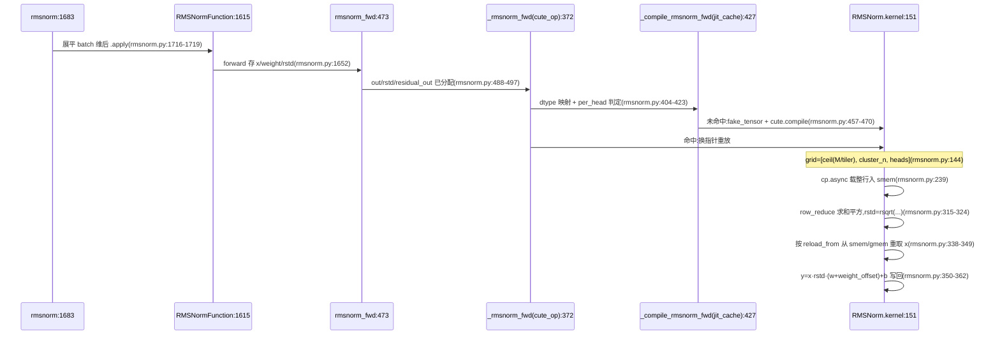

# 归约 kernel 家族

归约家族覆盖行归约类 kernel:rmsnorm/LayerNorm 前反向、softmax 前反向、cross-entropy 前反向、topk 前反向、`gemm_rms` 的第二段 rstd 归约。七个 kernel 类直接继承 `ReductionBase`(reduction_base.py:12),TopK 前向与 CrossEntropyBackward 两个例外不继承。host 侧不走 gemm_runtime:每个算子一条「torch 函数 → autograd Function → `@cute_op` 算子 → `@jit_cache` 编译 → kernel」的直线,没有 plan cache 与 registry。

约定:`路径:行号` 相对仓库根(模块内文件省略 DLKernel/ 前缀)。对照 2026-10-13 工作区源码核实,行号随代码演进漂移。标【推断】的是分析结论,其余为源码可见事实。

## 家族成员与入口

| 文件 | torch 入口 | autograd Function | `@cute_op` 算子 | 编译函数(`@jit_cache`) | kernel 类 |
|---|---|---|---|---|---|
| rmsnorm.py | `rmsnorm`:1683 | RMSNormFunction:1615 | `_rmsnorm_fwd`:372、`_rmsnorm_bwd`:1232 | `_compile_rmsnorm_fwd`:427、`_compile_rmsnorm_bwd`:1307 | RMSNorm:66、RMSNormBackward:614 |
| softmax.py | `softmax`:414 | SoftmaxFunction:400 | `_softmax_fwd`:193、`_softmax_backward`:373 | Softmax.compile:180、SoftmaxBackward.compile:357 | Softmax:26、SoftmaxBackward:216 |
| cross_entropy.py | `cross_entropy`:716 | CrossEntropyFunction:666 | `cross_entropy_fwd_out`:313、`cross_entropy_bwd_out`:619 | CrossEntropy.compile:269、CrossEntropyBackward.compile:550 | CrossEntropy:29、CrossEntropyBackward:394 |
| topk.py | `topk`:538 | TopKFunction:519 | `_topk_fwd`:234、`_topk_bwd`:461 | TopK.compile:217、TopKBackward.compile:442 | TopK:27、TopKBackward:275 |
| rms_final_reduce.py | `rms_final_reduce`:156 | — | `rms_final_reduce_out`:138 | `_compile_rms_final_reduce`:121 | RmsFinalReduce:27 |

链条各环(rmsnorm 前向为例):

1. torch 入口只做形状规整。`rmsnorm`:1716 先把 batch 维展平再进 autograd Function,张量秩只由 per_head 决定,dynamo 才能按 if 分支重编译(rmsnorm.py:1711-1715 注释)。
2. Function.forward 调 `rmsnorm_fwd`:473 分配 out/rstd/residual_out;rstd 只在 need_grad 时保存(rmsnorm.py:1640-1649)。
3. `@cute_op`(dsl/torch_library_op.py:29)把函数注册成 torch 算子 `dlkernel::_rmsnorm_fwd`(rmsnorm.py:365-372);mutating schema 手写,rmsnorm.py:369-370 注释说明是 mutating optional tensor 所致。
4. 算子体做 dtype 白名单与 per_head 判定(rmsnorm.py:395-409),调 `@jit_cache`(cache/jit.py:239)的编译包装器;jit_cache 按张量元数据缓存编译产物,命中直接重放。
5. 编译包装器用 `fake_tensor` 造符号形状张量走 `cute.compile`(rmsnorm.py:447-470);反向把 T 桶化到 2 的幂,JIT 键不随行数膨胀(`_bucket_T_hint`:42)。
6. 编译产物 launch kernel(rmsnorm.py:410-423 的调用形式是「先拿编译对象再立即调用」)。

rmsnorm 反向另有 functional custom op `dlkernel::rmsnorm_bwd_f`:1445 与 `rmsnorm_bwd_f_dual`:1487:分配在 op 内、带 register_fake,专供 torch.compile 插图;eager 走 `rmsnorm_bwd`:1367(分工见 rmsnorm.py:1380-1383 注释)。`rms_final_reduce` 是 `gemm_rms` 的第二段:`gemm_interface.py:3103` 对 per-tile 平方和 partials 调它求 rstd,`rms_final_reduce.py:2-4` 自述该定位。

## 与 GEMM 家族的 host 编排对照

| 维度 | GEMM 家族 | reduction 家族 |
|---|---|---|
| host 编排 | plan cache + identity/digest | `@cute_op` 每算子注册 + `@jit_cache` |
| 调度 | tile_scheduler 四模式持久化 | 裸 grid-stride 循环(rmsnorm.py:1002);单行 kernel 直接 grid 覆盖(softmax.py:81) |
| 变体组织 | epilogue/transform 两个挂载点 | 配置平铺(threads/cluster/reload),`@autotune` 搜平 config 列表 |
| 共享件 | copy_utils、layout_utils、pipeline、dsl 补丁、cache/jit、autotuner | 同左 |

【推断】(引 docs/architecture.md「链路三」的结论)分开两套模式的根因:GEMM 的变体爆炸在 epilogue 与操作数维度,需要 plan/registry 管理;归约的变体只在 N/dtype/cluster 配置维度,拉 GEMM 管线进来纯增复杂度。

## ReductionBase 公共形态

基类管三件事:cluster 配置、tiled copy 推导、归约缓冲与 mbarrier 分配;子类只写数学(kernel 主体是子类新定义,如 RMSNorm.kernel:151,不在覆写之列)。

`__call__` 的固定前奏(以 RMSNorm.__call__:108 为例):

1. `_set_cluster_n` 按架构钳 cluster:SM8x 无 cluster 恒 1,SM12x 上限 8、其余 16(rmsnorm.py:97-105)。
2. vecsize = gcd(N, 128 // 最大 dtype 位宽)(rmsnorm.py:126)。
3. `_cap_cluster_n`(reduction_base.py:28):`threads_per_row * cluster_n` 超过行内向量块数时压回 1,否则 local_tile 把所有 peer CTA 塌到 tile 0,cluster 归约双计同一批列(reduction_base.py:29-38)。
4. `_get_tiled_copy`(reduction_base.py:42)推导 tiler_mn 与 tiled_copy。
5. 分配 smem:整行 X 镜像(rmsnorm.py:172-174)+ 归约缓冲。`_allocate_reduction_buffer_and_mbar`(reduction_base.py:70)服务单次(非持久)kernel,`cluster_n > 1` 才分配 mbar(reduction_base.py:81-84);持久 kernel(rmsnorm 反向)改用 PipelineStasAsync(pipeline.py:387),空 barrier 支撑缓冲跨行迭代复用,分工见基类 docstring(reduction_base.py:73-75)与 rmsnorm.py:796-797 注释。

归约数据面三级,代数在 reduce.py:

| 级 | 函数 | 机制 |
|---|---|---|
| warp 内 | warp_reduce(reduce.py:22) | Int32 全架构、SM100 族 Float32 min/max 走 `redux.sync`,其余 shuffle butterfly |
| 跨 warp | block_reduce(reduce.py:93) | lane 0 写 smem 归约缓冲,barrier 后首 warp 逐列读回再 shuffle |
| 跨 CTA | cluster_reduce(reduce.py:114) | warp 0 `elect_one` 装一个 expect_tx,各 warp lane<cluster_n 用 `store_shared_remote`(STAS)远写 peer 缓冲,单 mbarrier 事务等待 |

主力入口 row_reduce(reduce.py:202)串三级:TensorSSA.reduce → warp shuffle →(warps_per_row>1 或 cluster_n>1 时)block_or_cluster_reduce(reduce.py:165)。多值归约传 tuple:同一 mbarrier 合并 expect 字节数,一次 cluster 往返覆盖全部值(reduce.py:123-129);LayerNorm 反向的 `mean(x_hat*wdy)` 与 `mean(wdy)` 就这样共享一对 barrier(rmsnorm.py:1090-1107)。online softmax 有专用 online_softmax_reduce(reduce.py:271):max 与 sum 以 f32x2 打包进一个 Int64 缓冲槽(reduce.py:310),第二次归约后按最终 max 在线修正 exp。

覆写钩子(基类有定义,子类覆写):

| 钩子 | 基类行为 | 覆写者 |
|---|---|---|
| `__init__`(:13) | 存 dtype/N/stage/reduction_dtype | 全部 7 个子类(architecture.md:362 记 8 个,现工作区实数 7,见文首约定) |
| `_threads_per_row`(:19) | raise NotImplementedError | RMSNorm:94、RMSNormBackward:661、Softmax:37、SoftmaxBackward:221、CrossEntropy:41、RmsFinalReduce:36 |
| `_num_threads`(:22) | 128(N≤16384)否则 256 | RMSNorm:91、RMSNormBackward:658、SoftmaxBackward:250、TopKBackward:285 |
| `_set_cluster_n`(:25) | cluster_n = 1 | RMSNorm:97、RMSNormBackward:664、Softmax:44、SoftmaxBackward:228、CrossEntropy:48、RmsFinalReduce:43 |
| `_get_tiled_copy`(:42) | 按 vecsize 推 tiler | 仅 TopKBackward:288(签名带 N 与 vecsize,行内线程数按 `N // vecsize` 直取,topk.py:293) |

softmax/cross_entropy 的 `_threads_per_row` 与 `_set_cluster_n` 是 N 阈值表(softmax.py:39、softmax.py:55-59);`CrossEntropy` 有 dx 时弃用 online softmax,因梯度重算需要 exp(x−max)(cross_entropy.py:297-299)。

### 成员 kernel 形态对照

| kernel | grid | 归约 op | 同步结构 | smem |
|---|---|---|---|---|
| RMSNorm.kernel:151 | [ceil(M/tiler), cluster_n, heads](rmsnorm.py:144) | ADD(ADD×2 当 LayerNorm) | 单次:reduction buffer + mbar | 整行 X 镜像(rmsnorm.py:172-180) |
| RMSNormBackward.kernel:741 | [sm_count, cluster_n, heads](rmsnorm.py:734) | ADD | 持久:PipelineStasAsync(:873-878)+ 可选 PipelineTmaAsync(:910-917) | sX/sdO 多 stage(rmsnorm.py:794-795) |
| Softmax.kernel:88 | [ceil(M/tiler), cluster_n, 1](softmax.py:81) | MAX、ADD,或 online(softmax.py:144-171) | 单次,stage=1(online)/2(softmax.py:28-34) | 整行 X 镜像(softmax.py:108) |
| SoftmaxBackward.kernel:276 | [ceil(M/tiler), cluster_n, 1](softmax.py:269) | ADD(Σ dy·y,softmax.py:339-347) | 单次,stage=1(softmax.py:219) | sdY、sY 双镜像(softmax.py:298-303) |
| CrossEntropy.kernel:115 | [ceil(M/tiler), cluster_n, 1](cross_entropy.py:108) | 同 Softmax;有 dx 时非 online(cross_entropy.py:297-299) | 单次 | 整行 X 镜像(cross_entropy.py:140-142) |
| TopKBackward.kernel:339 | [ceil(M/tiler), 1, 1](topk.py:333) | ADD(仅 softmax 分支,topk.py:413-419) | cluster 恒 1(topk.py:315 走基类 `_set_cluster_n`) | dx 的 smem scatter 板(topk.py:365-367) |
| RmsFinalReduce.kernel:67 | [ceil(M/tiler), 1, 1](rms_final_reduce.py:61) | ADD(rms_final_reduce.py:108-115) | cluster_n 恒 1(rms_final_reduce.py:43-44) | 无行镜像:gmem 直接进寄存器(rms_final_reduce.py:93-105) |

`RmsFinalReduce` 是家族里最薄的成员:`gemm_rms` 经 `sq_reduce_mod` 产出 per-tile 平方和 partials,它做第二段归约并 rsqrt(模块头注释 rms_final_reduce.py:2-4);接入点在 `gemm_interface.py:3103`,与 epilogue 版数值 bitwise 等价的说明在 epilogue/library.py:797。

入口链有一处家族内差异:rmsnorm 在 Function 与 cute_op 算子之间多一层 `rmsnorm_fwd`:473 / `rmsnorm_bwd`:1367 包装(分配输出、per_head 分派);softmax/cross_entropy/topk 的 Function 直接调各自的 `*_fwd`/`*_bwd` 函数,后者直接调 cute_op 算子(softmax.py:210-213、cross_entropy.py:368-391、topk.py:257-272)。编译包装器的挂点也不同:rmsnorm 挂模块级函数,softmax/cross_entropy/topk 挂类上的 `@staticmethod @jit_cache compile`(softmax.py:178-180),`@jit_cache` 本体是同一个(cache/jit.py:239)。

rmsnorm 还提供 nn.Module 形态:`DLKernelRMSNorm`(rmsnorm.py:1726)继承 torch.nn.RMSNorm,forward 转调 `rmsnorm`(rmsnorm.py:1755),drop-in 替换。模块内置参考实现 `rmsnorm_ref`:580、`rmsnorm_bwd_ref`:595、`layernorm_ref`:1860,tests 以它们为数值基线。

## 两个不继承基类的例外

| 例外 | 位置 | 形态 |
|---|---|---|
| TopK 前向 | topk.py:27 | 无行归约。整行装寄存器,索引编进值底部位保证并列时先列胜出(topk.py:116-127),`bitonic_topk` 排序取 k(topk.py:133),再 shuffle 拆发到多线程(topk.py:143-154)。无 smem 行镜像、无 cluster、无 mbarrier。约束:N/k 为 2 的幂、k≤128、N≤4096(topk.py:33-36)。 |
| CrossEntropyBackward | cross_entropy.py:394 | 纯逐元素:probs = exp2(x·log2e − lse·log2e),target 列换 probs−1,乘 dloss 与 class weight(cross_entropy.py:536-543)。无跨线程通信,故无基类的缓冲与 barrier;自带 `_get_tiled_copy`:407(行封顶 16k,超宽 N 由 2D grid 的 bidy 分块,cross_entropy.py:455-459),也不覆写 `_set_cluster_n`。 |

## rmsnorm 前向链路

LayerNorm 是同一 kernel 的 `is_layernorm` 分支:两遍归约(mean、variance)各占一个 stage,配 `reload_from` 二次取 x(rmsnorm.py:263-311)。weight_offset 是编译期常数,fp32 加进权重(rmsnorm.py:78-79、rmsnorm.py:354-356)。

## 反向:持久 grid-stride 与 partial 梯度

RMSNormBackward 是家族里唯一的持久 kernel:

- grid 为 `[sm_count, cluster_n, num_heads]`(rmsnorm.py:713、rmsnorm.py:734),行循环是 grid-stride(rmsnorm.py:1002),smem 预取 `NUM_PIPE_STAGES-1` 批(rmsnorm.py:949-1000)。
- 载入二选一:cp.async 多 stage 流水,或 TMA(`USE_TMA` 要求对齐与非 per_head,rmsnorm.py:650-652),TMA 用 PipelineTmaAsync(rmsnorm.py:910-917)。
- cluster>1 时归约缓冲的同步走 PipelineStasAsync(rmsnorm.py:873-878):producer/consumer 状态各一(rmsnorm.py:942-943),LN 双值合一个 barrier 对(rmsnorm.py:868-870)。
- dw/db 以 fp32 partial 按 CTA 累加(rmsnorm.py:855、rmsnorm.py:1158-1161),tile 内多行再经 smem 合并到 row 0(rmsnorm.py:1171-1213);host 侧 `sum(dim=0)` 收尾(rmsnorm.py:1395、rmsnorm.py:1434)。

## @autotune 调参

搜索空间是平的 config 列表(architecture.md「链路三」对照行),不含结构组合。仅 rmsnorm 前反向接入 `@autotune`(autotuner.py:756):

| 项 | 前向 | 反向 |
|---|---|---|
| config 字段 | RmsNormFwdConfig(rmsnorm_config.py:17):num_threads、threads_per_row、cluster_n、reload_from、delay_w_load(:18-25) | RmsNormBwdConfig(rmsnorm_config.py:95):再加 reload_wdy(:100)、reload_x(:101)、use_tma(:102)、smem_stages(:107) |
| 候选集 | get_all_fwd_configs(rmsnorm_config.py:405),launch 旋钮的 itertools 积 | get_all_bwd_configs(rmsnorm_config.py:442),`use_tma` 只在 SM90+ 进空间(rmsnorm_config.py:452) |
| `@autotune` | rmsnorm.py:526-530,key=`["is_layernorm", "per_head"]` | rmsnorm.py:1542-1546,key=`["per_head", "has_dw_partial", "has_db_partial", "is_layernorm"]` |
| policy | RmsNormTunePolicy:509,只覆 `prepare_candidates`(rmsnorm.py:522-523) | 同左,换 `prune_invalid_rmsnorm_bwd_configs`(rmsnorm_config.py:511) |
| 未 tune 路径 | `rmsnorm_fwd`:473 走解析启发式(rmsnorm_config.py:28) | `rmsnorm_bwd`:1367 走解析启发式(rmsnorm_config.py:110),Blackwell/Hopper 分派(rmsnorm_config.py:130-132) |

policy 只做合法性剪枝(threads_per_row × cluster_n ≤ N 等),不做性能猜测;TunePolicy 其余钩子取默认 exact key 与全候选 shortlist(rmsnorm.py:510-517 docstring)。TunePolicy 框架、评测协议与磁盘缓存在 ./autotuning_subsystem.md,本文不重复。

softmax、cross_entropy、topk、rms_final_reduce 没有 `@autotune` 入口:launch 参数完全由各 `_threads_per_row`/`_set_cluster_n` 的 N 阈值表决定(softmax.py:39、cross_entropy.py:43、rms_final_reduce.py:38)。

## 参考

- ../architecture.md:「reduction 家族与支撑层」「执行时序 → 链路三 rmsnorm 前向」
- ./autotuning_subsystem.md:tune 子系统全貌
- ./support_layer.md:copy_utils / layout_utils / reduce / dsl / pipeline 支撑层
