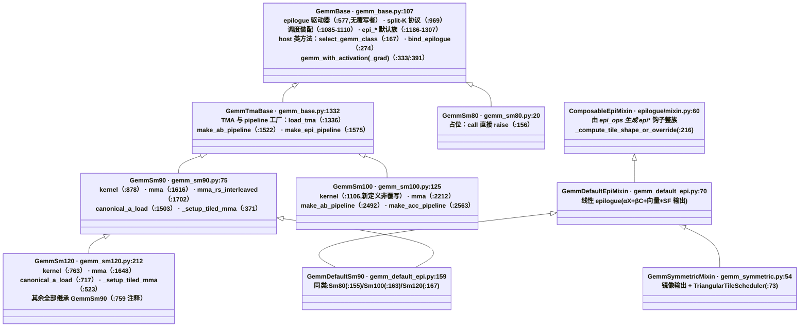

# SM 设备实现层

GEMM 的全部 `@cute.kernel` 设备代码住在这层。`gemm_base.py` 放四个架构共用的非 mainloop 件,epilogue 驱动器、split-K 协议、调度装配、`epi_*` 钩子默认实现;`gemm_sm80.py`、`gemm_sm90.py`、`gemm_sm100.py`、`gemm_sm120.py` 各放一份 mainloop。mixin(`gemm_default_epi.py`、`gemm_symmetric.py`)与 SM 类正交组合,一份 epilogue 数学服务四个架构。本文展开 [architecture.md](../architecture.md) 的「SM 设备实现层」与「多态方法速查」两节。

约定:`路径:行号` 相对仓库根(模块内文件省略 DLKernel/ 前缀)。对照 2026-10-13 工作区源码核实,行号随代码演进漂移。标【推断】的是分析结论,其余为源码可见事实。

## 继承树

图中省略两条腿:`_EpiModMixinBase`(epilogue/visit.py:20,经 `@gemm_epilogue` 铸出的 kernel 类走它)与 `GemmMoeSm90`(fused_grouped_gemm/gemm_sm90.py:34,设备侧零覆写)。铸出类的基类可为 Sm90/Sm100/Sm120 任一,见 [architecture.md](../architecture.md)「多态方法速查」。

## GemmBase:epilogue 数据路径与 host 类方法

`GemmBase`(`gemm_base.py:107`)的 docstring 写明:Common non-mainloop pieces。它持四组公共件:

| 成员 | 位置 | 作用 |
|---|---|---|
| `epilogue` | gemm_base.py:577 | epilogue 统一驱动器,四个架构共用同一份,无任何覆写者 |
| `epilogue_split_k` | gemm_base.py:969 | split-K 终结协议:SERIAL/PARALLEL 下非终结 split 只把 raw f32 部分和提交到 workspace,最后一个 split 等 tile 完成标志、fold 进累加器、跑完整 epilogue;SEPARATE 下每个 split 存自己的 partial,由 `split_k_reduce.py` 第二 kernel 归约(:995-1001) |
| `get_scheduler_class` / `get_scheduler_arguments` | gemm_base.py:1085 / :1092 | 调度装配。持久化模式在 :1103-1110 选定:`arch >= 100 且 use_clc_persistence` 走 CLC(:1105-1106),有 tile-count semaphore 走 DYNAMIC(:1107),否则 STATIC |
| `epi_*` 钩子默认族 | gemm_base.py:1186-1307 | `epi_begin`:1198(默认返回空)、`epi_end`:1254、`epi_to_underlying_arguments`:1267、`epi_get_tma_atoms`:1272、`epi_smem_bytes`:1293、`epi_setup_aux_out`:1307 等;默认实现是保守版本,整族被 ComposableEpiMixin 覆写 |

host 侧类方法也定义在 `GemmBase` 上:`select_gemm_class`(`:167`)、`register_kernel_variant`/`resolve_kernel_variant`(`:212`/`:256`,kernel_variant 令牌注册与解析)、`bind_epilogue`(`:274`)、激活族入口 `gemm_with_activation`/`gemm_with_activation_grad`(`:333`/`:391`)。

设备侧与 host 侧的分界写在类里:`gemm_base.py:161-164` 的节注释是 "plain Python; device code never calls these"。设备代码指 `@cute.jit`/`@cute.kernel` 方法;host 类方法是纯 Python classmethod,消费方是 epilogue 前端铸类与 `gemm_runtime/host.py`。`select_gemm_class` 的 docstring 也约束了边界:只返回类、不编译、不实例化(`:170-171`)。

split-K 配置是 `GemmBase` 的类属性:`split_k`:142、`split_k_mode`:143;`split_k > 1` 与 `gather_A` 互斥,`_init_split_k` 里 assert(`:574`)。

## GemmTmaBase:TMA 与 pipeline 工厂

`GemmTmaBase`(`gemm_base.py:1332`)是 SM90+ 共用的 TMA 描述符与 pipeline 层:

- `load_tma`:1336,AB 生产者循环模板,producer_acquire/commit/advance。
- `make_ab_pipeline`:1522,AB pipeline 工厂。pipeline 类在 `:1565` 选定:常规走 `PipelineTmaAsync`,`gather_A` 时换 `PipelineTmaCpAsync`(A 侧改 cp.async,32 lane 各自 arrive)。
- `make_epi_pipeline`:1575,C 加载 pipeline,`PipelineTmaAsync.create`(`:1594`)。
- gmem tiled copy 与 TMA atom 工厂(`:1366` 起)。

覆写只有一处:`GemmSm100.make_ab_pipeline`(gemm_sm100.py:2492)换成 `PipelineTmaUmma`(`:2544`),并新增 `make_acc_pipeline`(`:2563`,`PipelineUmmaAsync.create`:2584)连接 MMA 与 epilogue。SM80 不继承此层(无 TMA)。

## 四个 SM 类的 mainloop

| | GemmSm80 | GemmSm90 | GemmSm100 | GemmSm120 |
|---|---|---|---|---|
| 继承 | GemmBase | GemmTmaBase | GemmTmaBase | GemmSm90 |
| MMA | warp mma.sync(MmaF16BF16Op,:129) | WGMMA warpgroup | tcgen05.mma,1/2-CTA(:293) | warp mma.sync(m16n8k16/k32) |
| A 进 MMA | smem(设计) | smem 直读,或寄存器(RS mainloop) | smem(tcgen05) | 恒为寄存器,显式 ldmatrix |
| AB pipeline | cp.async(未接通) | PipelineTmaAsync/gather_A 时 CpAsync | PipelineTmaUmma | 继承 SM90 |
| 累加器介质 | 寄存器 | 寄存器 | TMEM | 寄存器 |
| warp 角色 | 全 CTA 混合 | mma warpgroup 1-3 个 + producer warpgroup | 六类单 warp 角色 | 同 SM90 结构 |
| 状态 | 占位 | 生产 | 生产 | 生产 |

### GemmSm90:WGMMA、pingpong、varlen+gather_A

`kernel` 在 `gemm_sm90.py:878`。每 CTA 角色分成两组(`:83-86`):`mma_warp_groups` 个 warpgroup 跑 WGMMA 加 epilogue(cooperative 模式同做一块 tile;pingpong 模式两个 warpgroup 交替),加一个 producer warpgroup,内含 AB-load warp(gather_A 时换成 4 个 cp.async warp)、C-load warp、scheduler warp。`mma_warp_groups` 取 1-3(`:289`);pingpong 要求它为 2 且 tile M ∈ {64,128,192}(`:255`,`:287-288`)。

varlen+gather_A 路径:`load_AB_gather_A`(`:1513`),B 走 TMA、A 走 cp.async(`:1528-1536`),轮换 TMA warp(`:1536`);与 split-K 互斥(gemm_base.py:574)。

A 侧有两个入口。`canonical_a_load`(`:1503`)是 canonical produce:ldmatrix s2r,major mode 来自 WGMMA op。`mma_rs_interleaved`(`:1702`)是 RS mainloop:A fragment 常驻寄存器,`copy_block(stage, b, k_tile)` 在 WGMMA(k) 与 WGMMA(k+1) 之间产块,一个 k16 块一个 commit group,`wait_group(mma_k - 2)` 是最深安全等待(`:1716-1731`),setup 处 assert `mma_k >= 4`(`:1729-1730`);slow-accum 变换经 `promote_fn` 逐 tile 折叠(`:1733-1741`)。`operand_transform/` 的解码与 dropout 就挂在这个 `copy_block` 缝上。

`_setup_tiled_mma`(`:371`)选 WGMMA op;`_sf_smem_bytes_per_stage`(`:367`)恒返回 0,SM90 没有真 scale factor(`kernel` 签名注释 `:885-886`:real scale factors are SM120-only)。

### GemmSm100:tcgen05、TMEM、六 warp 角色、CLC

`kernel` 在 `gemm_sm100.py:1106`,是基类没有同名方法的新定义。MMA 是 tcgen05.mma:`cta_group` 按 `use_2cta_instrs` 取 TWO/ONE(`:293`);2-CTA 由 cluster M 偶数与 mma tiler M ∈ {128,256} 共同推导(`:262`)。

六类 warp 角色的 id 装配在 `:295-306`:epilogue×4(`epi_warps_per_accumulator`:298)、MMA、AB-load(gather_A 时 4 个)、C-load、scheduler、A-prefetch(仅 gather_A)。AB pipeline 的 empty 侧由硬件 tcgen05.commit 发信号(`:137-138` docstring),SM90 则是每 mma warp 一个 arrive。

累加器在 TMEM:`TmemAllocator`(`:1202`)分配列,epilogue 经 tcgen05.ld 取;SF 与累加器可叠放同一片 tmem(`:637-658`)。MMA 与 epilogue 之间多一条 acc pipeline:`make_acc_pipeline`(`:2563`),2-CTA 时两 CTA 的 epi warp 都路由到 leader CTA 的 barrier(`:2565-2576`)。

持久化:`is_persistent` 恒 True(`:270`),`use_clc_persistence` 默认 True(`:221`),调度走 PersistenceMode.CLC(gemm_base.py:1105-1106);CLC 查询节流用的 NamedBarrier 定义在 `:312-319`。

blockscaled:`sf_vec_size` 非 None 即 blockscaled(`:259`);SFA/SFB 随 AB pipeline 走(docstring `:152`);blockscaled 与 split-K 可组合但拒绝 SEPARATE(`:289-291`)。

### GemmSm120:继承 SM90,只换 MMA 与 kernel 主体

`GemmSm120(GemmSm90)`(`gemm_sm120.py:212`)。类 docstring 列出差异(`:215-226`):warp 级 mma.sync 替代 WGMMA;smem→rmem 需显式 ldmatrix;fp8 只 k-major;无 slow-accum 路径(fp8 mma.sync 的 f32 累加保 21-22 位尾数,per-tile promote 无收益)。warp 角色与 pipeline 结构照抄 SM90(`:236-242`),但无 cluster,A/B multicast 对端恒为 1(`:238-239`)。

覆写四处:`_setup_tiled_mma`(`:523`)、`canonical_a_load`(`:717`,显式传 smem major,warp-MMA op 不携带)、`kernel`(`:763`)、`mma`(`:1648`)。`__call__`、`_setup_attributes`、`make_ab_pipeline`、`make_epi_store_pipeline`、`make_sched_pipeline`、`epilogue` 全部继承,`:759-760` 注释逐一点名。

A 恒 register-sourced,value fn/dropout 包装 canonical load,layout-owning W4 解码整体替换它(`:228-231`),与 SM90 共用 `operand_transform/` 的 `copy_block` 契约。W4A8 promote 路径尚未移植,仍是 SM90-only(`:233-234`)。smem 预算差异落到 `epi_c_stage_base = 2`(`:267`),SM90 是 4(`gemm_sm90.py:152`)。

### GemmSm80:占位

`GemmSm80(GemmBase)`(`gemm_sm80.py:20`)。`__init__` 与 `_setup_tiled_mma`(`:128`,MmaF16BF16Op)已写,epilogue 钩子按 docstring(`:24-25`)复用标准组合件;但 `__call__` 直接 raise NotImplementedError(`:156`),没有可用 kernel。`sm_to_cls` 仍把 major 8 映到 `GemmDefaultSm80`(gemm.py:94),该路径在 SM80 硬件上一调用即 raise。

## 为什么按 SM 分子类

mainloop 无法参数化,三个维度互斥:

- pipeline 类型:SM90 的 AB pipeline 是 `PipelineTmaAsync`(gather_A 换 `PipelineTmaCpAsync`,gemm_base.py:1565,empty 侧每 mma warp 一个 arrive,gemm_sm90.py:90);SM100 是 `PipelineTmaUmma`(gemm_sm100.py:2544),empty 侧信号由硬件 tcgen05.commit 产生(`:137-138`)。两套 arrive/commit 协议不同,pipeline 类型不可互换。
- warp 角色数:SM90 是 warpgroup 粒度、1-3 个 mma warpgroup 加 producer(gemm_sm90.py:83-86);SM100 是六类单 warp 角色(gemm_sm100.py:295-306)。角色数写死在 NamedBarrier 线程数、pipeline arrive count 与 kernel 内的分派里。
- 累加器介质:SM90/SM120 的累加器是寄存器,mma 循环直接消费 rmem tensor;SM100 的 tcgen05.mma 写 TMEM,epilogue 经 acc pipeline 取。寄存器分配与 TMEM 列分配是两套互斥的代码。

【推断】若合并成带运行时分支的单 kernel,CUDA 以整个 kernel 为编译单位,分支不消除寄存器/TMEM 分配与指令选择,所有架构都背上最重一份的寄存器压力与 smem 占用。子类隔离让每代只编译自己的路径;代价是跨架构共有的行为要在多份 mainloop 里同步修改。

基类收走可共享的部分:epilogue 数据路径、split-K、调度装配在 `GemmBase`,TMA/pipeline 工厂在 `GemmTmaBase`。子类只交 mainloop、MMA atom、`canonical_a_load`/`copy_block`。

## mixin 与 SM 类正交

mixin 单独不继承 `GemmBase`(`ComposableEpiMixin` 无基类,epilogue/mixin.py:60)。组合类写成 `class GemmDefaultSm90(GemmDefaultEpiMixin, GemmSm90)`(gemm_default_epi.py:159),MRO 中 mixin 腿整体排在 SM 腿之前,mixin 的同名方法盖过 SM 腿。一份线性 epilogue 数学经四个组合类服务四个架构(gemm_default_epi.py:155-167);`GemmSymmetricMixin`(gemm_symmetric.py:54)在默认 op 词表上加镜像输出 `TileStore`(`:61-63`),换 `TriangularTileScheduler`(`:73-74`),组合类在 `:83-95`。

`_compute_tile_shape_or_override` 有两条腿:

| 腿 | 实现 | 行为 |
|---|---|---|
| SM 腿 | GemmSm90:2093 → GemmSm120:1786 | 由 atom layout 推 epi tile |
| mixin 腿 | ComposableEpiMixin(epilogue/mixin.py:216) | 先问 tile-store op 的静态 epi-tile override,再回落默认推导 |

组合类因 MRO 在前走 mixin 腿;不掺 mixin 的 SM 链才用 SM 自己的版本。`epi_visit_subtile`/`epi_to_underlying_arguments` 同理:`GemmBase` 默认(`:1218`/`:1267`)被 mixin 腿(`gemm_default_epi.py:128`/`:117`)盖过。

`gemm_w4.py` 不写 kernel。两个入口都是 `EpiMod.gemm(..., transform_a=...)` 调用(`gemm_w4.py:16-21` docstring),设备代码复用 GemmSm90 的 RS mainloop 与 A-transform 挂载点;该文件只剩 host 面:prepare、校验、W4 config 规则、split-K buffer 复用。挂载点契约见 [operand_transform.md](./operand_transform.md)。MoE role 类与铸出类同样骑在 SM 基类上,host 契约见 [fused_grouped_gemm.md](./fused_grouped_gemm.md)。

## 每个 SM 类的硬性约束

| 类 | 硬性约束 | 出处 |
|---|---|---|
| GemmSm80 | pingpong 禁止;cluster 禁止;`__call__` 不可用 | gemm_sm80.py:63、:64、:156 |
| GemmSm90 | cluster M/N 为 2 的幂且总数 ≤ 4;16-bit A/B 同 dtype,fp8 只 k-major;RS mainloop 要求 mma_k ≥ 4;split_k 与 gather_A 互斥 | gemm_sm90.py:130、:117-119、:1729-1730;gemm_base.py:574 |
| GemmSm100 | mma tiler M ∈ {64,128}(1-CTA)或 {128,256}(2-CTA);N ∈ 32-256 步 32;cluster 总数 ≤ 16;2-CTA 要求 cluster M 偶数;blockscaled split_k 拒绝 SEPARATE;SF tmem 按 64-N 粒度读写 | gemm_sm100.py:190-193、:289;AGENTS.md「Measured facts」 |
| GemmSm120 | 无 cluster;smem 上限 101376 B;fp8 只 k-major;W4A8 promote 未移植;epi C stage 上限 2 | gemm_sm120.py:238-239、:253、:221、:233-234、:267 |

SM100 的 register 调配(spilling)案例见 [register_spilling_sm100.md](../notes/register_spilling_sm100.md);SM120 的规格实测见 [sm120_hardware.md](../notes/sm120_hardware.md)。

## SM 选择入口

两条静态映射,一个按 device capability major 选组合类,一个选泛型基类:

| 入口 | 位置 | 映射 |
|---|---|---|
| 线性族 dispatch | gemm.py:93 `sm_to_cls` | 8→GemmDefaultSm80、9→GemmDefaultSm90、10/11→GemmDefaultSm100、12→GemmDefaultSm120(`:100` 取用) |
| `GemmBase.select_gemm_class` | gemm_base.py:167 | generic root(`supported_sm_majors` 为 None)把 major 映到 generic SM 基类;声明了集合的类按集合自校验 |

自校验:每个具体 SM 类声明 `supported_sm_majors`,major 不在集合内时 `select_gemm_class` raise TypeError(gemm_base.py:204-208)。四个声明:SM80 `(8,)`(gemm_sm80.py:32)、SM90 `(9,)`(gemm_sm90.py:145)、SM100 `(10, 11)`(gemm_sm100.py:207,B300 报 capability major 11 而 `arch` 仍为 100)、SM120 `(12,)`(gemm_sm120.py:250)。SM120 的声明是显式覆写:继承 `GemmSm90` 不会自动继承适用性,`:246-249` 注释写明 inherited `(9,)` 会错误认领 Hopper。epilogue 族铸类经 `select_gemm_class` 拿 Gemm 类,过程见 [architecture.md](../architecture.md)「绑定与身份机制」。

## 相关文档

- [architecture.md](../architecture.md):全库地图、「多态方法速查」的覆写矩阵、「目标硬件差异」。
- [fused_grouped_gemm.md](./fused_grouped_gemm.md):`GemmMoeSm90` role 类,设备侧零覆写,受限构造收窄到 SM90 已特化路径。
- [operand_transform.md](./operand_transform.md):`copy_block` 挂载点、W4/W8 打包解码格式。
- [../notes/sm120_hardware.md](../notes/sm120_hardware.md)、[../notes/register_spilling_sm100.md](../notes/register_spilling_sm100.md):两个架构的硬件实测记录。
